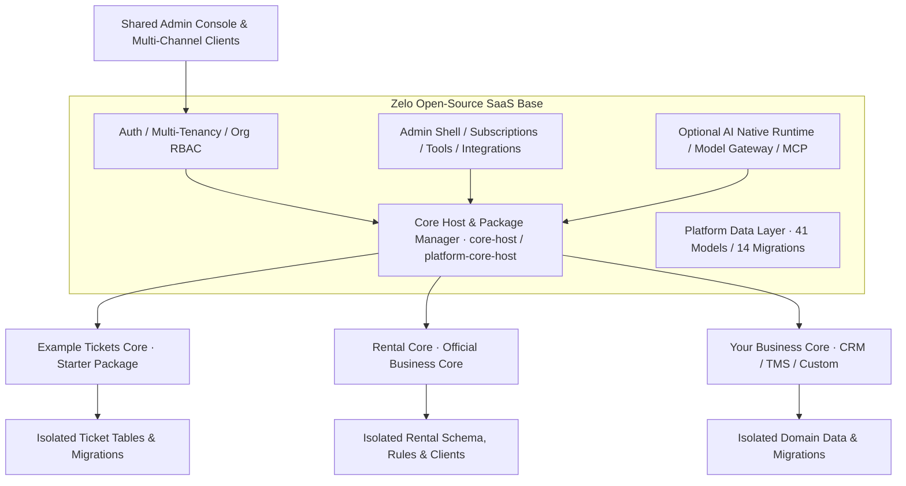

# Zelo

<picture>
  <source media="(prefers-color-scheme: dark)" srcset="packages/platform-admin/public/brand/zelo-logo-white.svg">
  
</picture>

**An open-source, multi-tenant SaaS foundation built for AI-native business applications.**

*面向 AI Native 应用的开源多租户 SaaS 底座。*

[](LICENSE)
[](https://github.com/JinPen-G/Zelo/releases/tag/v0.1.18)
[](package.json)
[](tsconfig.base.json)
[](apps/platform-api/README.md)
[](apps/platform-admin/README.md)
[](apps/platform-api/README.md)

[简体中文](README.md) | **English**

---

**Zelo** is a standalone, open-source, multi-tenant SaaS foundation. It distills the infrastructure nearly every B2B SaaS product has to rebuild from scratch—authentication, multi-tenancy and organizational RBAC, SaaS subscriptions, a shared admin console, encrypted external integrations, an optional governed AI Native / MCP runtime, and a standardized **pluggable Core lifecycle with independent upgrades**—into a clean, industry-agnostic base.

Domain applications plug into the base as standalone **Cores (business packages)**, each owning its own domain schema, SQL migrations, admin UI contributions, and optional AI tools. **The base starts, builds, and exports cleanly with zero Cores installed.** This repository also includes the lightweight starter **Example Tickets Core** and the first official business Core—**[Rental Core](#built-in-business-core-examples)** (also published independently at [JinPen-G/Zelo-rental-core](https://github.com/JinPen-G/Zelo-rental-core))—as runnable demos and reference implementations for building CRM, TMS, ticketing, or any vertical SaaS Core.

> **Quick Navigation**: [Why Zelo](#why-zelo) · [Core Capabilities](#core-capabilities) · [Architecture & Core Model](#architecture--core-extension-model) · [5-Step Core Integration](#integrate-your-business-core-in-5-steps) · [Core Ecosystem & Monetization](#build-the-core-ecosystem--monetize-extensions) · [Built-in Core Examples](#built-in-business-core-examples) · [Quick Start](#quick-start) · [Repository Structure](#repository-structure) · [Developer Guide](#developer-guide) · [Verification](#verification--testing) · [Contributing](#contributing)

---

## Why Zelo

- **Zero-Core Standalone Runtime & One-Command Source Export**: Ships with standalone `platform-api` and `platform-admin` backed by 41 shared platform models and 14 base migrations. Run `npm run export:platform` to produce a clean base source archive containing zero industry business code.
- **Standardized Core Contracts & Independent Upgrades**: Every business Core declares its manifest, permissions, UI routes, OpenAPI schema, and raw SQL migrations through `@rental-os/core-contracts`. The built-in **Core Packages Console (`/platform/core-packages`)** discovers public packages by GitHub Topic (`zelo-core`), verifies release SHA-256 digests, and locks deployments so **the base and each Core upgrade or roll back independently**.
- **Multi-Tenancy & Admin Shell**: Includes two-tier SaaS/tenant identity, organizations and RBAC permission trees, email member invitations, security baselines, dictionaries and numbering rules, subscription windows, AES-GCM credential encryption, email/SMS/file/payment primitives, and a modern React 19 + UIArc admin shell.
- **Optional, Strictly Governed AI Native & MCP**: AI is an opt-in capability layer—standard business flows run without it. When enabled, it provides unified task orchestration and recovery, a single Model Gateway, financial budget ledgers, knowledge ACLs, human approval linkage, original-receipt reconciliation, and RFC-compliant OAuth-protected MCP transport with a Harness client plugin.
- **Built for Developers & AI Coding Agents**: Provides a [5-Step Integration Guide](packages/core-contracts/README.md#五步快速接入), a copy-ready [Agent Task Template](packages/core-contracts/README.md#交给开发agent的任务模板), a static Core package verifier (`check.js`), and a unified capability index CLI (`capabilities.js`) to inspect existing base components, pages, APIs, and exports in one command.

---

## Core Capabilities

Zelo enforces a clean separation between the reusable **Platform Base** and pluggable **Business Cores**:

### 1. Zero-Core Base Capabilities

| Capability Domain | Built-in Platform Implementation | Source Modules |
| --- | --- | --- |
| **Identity, Multi-Tenancy & Security** | Two-tier SaaS/tenant accounts, JWT refresh & revocation, first-login password change, tenant lifecycle, organizations, RBAC trees, login rate limiting, security baseline | [platform-server](packages/platform-server/README.md) · [platform-contracts](packages/platform-contracts/README.md) |
| **Shared Admin Shell & UI** | Unified app shell, responsive sidebar & zero-Core empty state, light/dark/system themes & brand accent, Chinese/English UI switching, profile, tenant/staff/org/security/subscription/integration settings, plus Core UI primitives (`CorePage`, `useCoreForm`, `CoreList`, `useCoreRequest`) | [platform-admin](packages/platform-admin/README.md) · [UIArc](packages/ui-arc/README.md) |
| **Subscriptions & Platform Tools** | Tenant subscription catalog & term enforcement, dictionaries, auto-numbering rules, saved filter presets, website demo requests, persistent rate limiting | [platform-api](apps/platform-api/README.md) |
| **Messaging & Base Integrations** | Operator email invitations & public acceptance flow, SMTP/IMAP outbound & support inbox, AES-GCM encrypted credential vault, storage readiness checks, notifications & async job ledgers, official calendar sources | [platform-server](packages/platform-server/README.md) |
| **Core Lifecycle & Package Management** | Standard Core registration & compatibility checks, SaaS tenant grants, tenant member assignments, bind/disable/remove dependency checks, GitHub Topic discovery, pinned release verification & upgrade preflight | [core-contracts](packages/core-contracts/README.md) · [core-host](packages/core-host/README.md) · [platform-core-host](packages/platform-core-host/README.md) |
| **Optional AI Native & MCP** | Task orchestration & recovery, unified Model Gateway, financial budget ledger, knowledge & memory ACL policies, approval & receipt reconciliation, RFC 9728/8414 OAuth-protected MCP transport & Harness plugin | [ai-native-server](packages/ai-native-server/README.md) · [ai-native-data](packages/ai-native-data/README.md) · [mcp-server](packages/mcp-server/README.md) · [harness-plugin](clients/harness-plugin/README.md) |

### 2. Responsibility Boundary: Base vs. Business Core

| Dimension | Owned by Zelo Base | Owned by Business Core |
| --- | --- | --- |
| **Identity & Multi-Tenancy** | Accounts, sessions, tenants, organizations, base roles, and trusted request context | Domain roles, business containers (workspaces/projects/stores), and fine-grained data scope |
| **Authorization & Subscriptions** | Deployment admission, tenant Core grants, member Core assignments, subscription terms & revocation | Domain permission codes, action preconditions, and entitlement boundaries |
| **Admin Console** | Login, sidebar/header/breadcrumbs, theme, locale, shared settings, and session cache isolation | Declared routes, page bodies, primary actions, and deep links via official Core contributions |
| **Data & Upgrades** | 41 base models & migration chain, deployment lock checks, independent upgrade preflight | Domain tables & raw SQL migrations, historical read-only compatibility, and in-flight drain |
| **AI Native** | Runtime orchestration, Model Gateway, budget & usage accounting, approval linkage & recovery | Trusted domain facts, optional AI tools, authoritative business execution, and original receipts |
| **Shared Primitives** | File primitives, notification/email channels, encrypted integrations, audit logs & job hooks | Domain file ACLs, field exposure scope, message copy, and domain event facts |

---

## Architecture & Core Extension Model



### Runtime Modes & Authorization Isolation

- **Two-Tier Core Authorization**: SaaS administrators first grant installed Cores to a tenant under **Tenant Core Grants**; tenant administrators then assign specific Cores and fine-grained domain roles to individual members under **Member Core Assignments**.
- **Pinned Deployment Locks & Independent Upgrades**: Hosts pin the base release, Core package SHA-256 digests, contract versions, and optional AI data packages in `core.deployment.lock.json`. Base upgrades and single-Core upgrades run independently after compatibility and migration preflight, preserving existing business data, grants, and historical receipts across upgrades and rollbacks.
- **Strictly Opt-In AI**: A Core can ship with zero AI tools and run full business UIs and APIs normally. When AI is enabled, every tool call is enforced by current identity, tenant grant, member assignment, AI policy, and human approval; `unknown` outcomes reconcile strictly by original operation key and receipt—never auto-retrying blindly.

| Assembly Mode | Runtime Behavior | Reference Host |
| --- | --- | --- |
| **Zero-Core (Base Only)** | Standalone login with full tenant/org/role/security/subscription/dictionary/integration/messaging/Core management; displays a clean zero-Core onboarding state | [platform-api](apps/platform-api/README.md) + [platform-admin](apps/platform-admin/README.md) |
| **Single Core** | Loads only the chosen Core with its own SQL migrations and UI routes, carrying zero unrelated industry code | [example-tickets-api](apps/example-tickets-api/README.md) / [rental-api](apps/rental-api/README.md) |
| **Multi-Core Coexistence** | Runs multiple Cores side by side in one deployment and tenant with shared auth and strict permission, route, data, and cache isolation | [Dual-Core example in the Rental repository](https://github.com/JinPen-G/Zelo-rental-core/blob/main/README.en.md#rental-and-tickets-example) |
| **Disable & Re-enable** | Disabling a Core blocks new writes while preserving existing data, settings, receipts, and in-flight completion; re-enabling restores access under current grants | Built-in Core lifecycle |

---

## Integrate Your Business Core in 5 Steps

You can build and attach a new domain Core without modifying base source code. Follow the [5-Step Integration Guide](packages/core-contracts/README.md#五步快速接入) (or hand the [Agent Task Template](packages/core-contracts/README.md#交给开发agent的任务模板) plus your domain requirements to your coding agent):

1. **Declare Manifest & Migrations**: Following [example-tickets-core](packages/example-tickets-core/README.md), declare your Core ID, version, compatibility range, permission codes, entrypoints, and standalone SQL migrations.
2. **Implement Domain Services & Single-Source HTTP / OpenAPI**: Reuse base auth, authorization, and transaction scopes, deriving runtime validation and OpenAPI specs from the same schema. AI tools are entirely optional.
3. **Contribute Admin Pages & Primary Actions**: Reuse `CorePage`, `useCoreForm`, `CoreList`, and `useCoreRequest` from `@rental-os/platform-admin/core` to inherit sidebar navigation, breadcrumbs, theming, validation, unsaved-change guards, and cache isolation (see [Core Page Guide](packages/platform-admin/src/core/README.md)).
4. **Build & Verify a Standard Core Package**: Produce a standard `.tgz` package containing `core.manifest.json`, compiled entrypoints, `openapi.json`, `CORE_GUIDE.md`, `README.md`, `LICENSE`, and raw SQL migrations, then validate zero violations with `check.js`.
5. **Assemble in Host & Grant Access**: Install the verified package and lockfile in a host, apply migrations, register Core permissions, grant the Core to tenants as a SaaS admin, and assign members as a tenant admin.

### Essential Developer & Agent CLIs

```bash
npm run build -w @rental-os/core-contracts

# 1. Unified Capability Index: query existing base components, pages, APIs, and exports
node packages/core-contracts/dist/capabilities.js --query SaveButton --json
node packages/core-contracts/dist/capabilities.js --query ticket --kind page --json

# 2. Standard Core Package Verifier: validate manifest, paths, OpenAPI, license & host compatibility
node packages/core-contracts/dist/check.js <unpacked-core-dir> --host <host-version-json> --json

# 3. Export a clean zero-Core base source tarball (no business Cores; includes standalone lockfile & pack scripts)
npm run export:platform -- --repo . --repository https://github.com/JinPen-G/Nativark --commit <full-sha> --out zelo-platform.tgz
```

> **Online Core Discovery & Distribution**: Make your standalone Core repository public on GitHub, add the topic **`zelo-core`**, and attach your standard `.tgz` artifact to a GitHub Release. Any Zelo base can then discover it online in **Core Packages (`/platform/core-packages`)**, verify compatibility and SHA-256 digests, and stage installation. See [Core Package Host Integration](packages/platform-core-host/README.md#core-包管理接入) · [Admin Package Console](packages/platform-admin/src/features/core-packages/README.md).

---

## Build the Core Ecosystem & Monetize Extensions

Zelo exists so engineering teams across industries no longer have to rebuild auth, multi-tenancy, RBAC, subscriptions, and admin consoles from scratch. **We warmly invite vertical developers, indie teams, and ISVs to build and open-source more industry Core packages on Zelo**—from CRM, ERP, WMS, TMS, and ticketing to scheduling, education, healthcare, asset maintenance, and multi-store retail—to grow a thriving open SaaS ecosystem together.

### Why Build Your Business Core on Zelo

- **Zero Coupling, Independent Cadence**: Every Core owns its own repository, SQL migrations, admin UI pages, and release schedule without being tied to Zelo base releases.
- **Enterprise Readiness Out of the Box**: Inherit multi-tenancy, org RBAC trees, subscription enforcement, encrypted credentials, messaging primitives, and optional governed AI Native / MCP—so you focus 100% on domain logic.
- **Built-in Discovery & Distribution**: Tag a public GitHub Core repository with **`zelo-core`** and attach a standard `.tgz` release asset to make it discoverable directly inside `/platform/core-packages` on any Zelo deployment.

### Open-Friendly Commercialization & Paid Extensions

Because the Zelo base is released under the permissive **[MIT License](LICENSE)**, **you keep full ownership over your Core's license and business model**. We welcome open-source collaboration and equally support sustainable developer monetization:

- **Open Core + Paid Extensions**: Open-source your base vertical Core to grow community adoption, while selling **paid extension modules, vertical add-ons, branded client apps (web portals / Mini Programs / mobile), deep ERP/accounting/IoT connectors, or specialized AI workflow packs** on top of your own Core.
- **Standalone Commercial Cores**: Build and distribute proprietary or commercially licensed vertical Cores through per-tenant licensing, SaaS subscriptions, or private on-prem delivery.
- **Implementation & Managed Services**: Offer private deployment, custom integration, data migration, and enterprise SLA support around the Cores you maintain.

> Note: As long as you retain Zelo's MIT copyright notice and follow standard Core isolation contracts, you are free to define your own license terms, entitlement checks, and pricing for your Cores and commercial extensions. Once you publish an open-source or open-core package, tag it with `zelo-core` and share it via GitHub Issues or Discussions so the community can discover it.

---

## Built-in Business Core Examples

This repository contains the platform base, the Tickets example, and Rental compatibility sources. The standalone Rental repository maintains the Rental and Tickets composite host:

### 1. Example Tickets Core (Lightweight Starter)
- **Purpose**: Minimal non-rental business Core template scoped strictly by tenant—no stores, inventory, payments, or AI dependencies.
- **Demonstrates**: Ticket create → assign → start → close across 3 isolated tables, idempotency & original operation receipts, server-side search/pagination, 4 admin pages, and disable/re-enable boundaries.
- **Entrypoints**: [Core Source](packages/example-tickets-core/README.md) · [Tickets API Host](apps/example-tickets-api/README.md) · [Tickets Admin Host](apps/example-tickets-admin/README.md)

### 2. Rental Core (Official Production Business Core)
- **Purpose**: Zelo's first full-featured vertical Core, serving as a comprehensive architectural reference for complex domains—**it is a pluggable business package on top of the base, not the base itself**.
- **Demonstrates**: End-to-end rental workflows across 4 categories (photography gear, camping equipment, vehicles, construction machinery)—catalog, assets, inventory, pricing strategies, quotes, orders, dispatch, return, inspection, settlement, and enterprise credit—supporting both non-AI and optional AI Native assemblies, paired with 4 client apps (tenant storefront, enterprise portal, customer & staff WeChat Mini Programs).
- **Standalone Repository & Releases**: Also open-sourced at **[JinPen-G/Zelo-rental-core](https://github.com/JinPen-G/Zelo-rental-core)** with standard release packages on [GitHub Releases](https://github.com/JinPen-G/Zelo-rental-core/releases) discoverable directly via the base's GitHub Topic (`zelo-core`) workflow.
- **In-Repo Entrypoints**: [Rental Core Guide](packages/rental-core/README.md) · [Rental API Host](apps/rental-api/README.md) · [Rental Admin Host](apps/rental-admin/README.md)

### 3. Multi-Core Composite Host (Dual-Core Reference)
- **Purpose**: Mounts both **Rental Core** and **Example Tickets Core** together on a single shared identity layer, database, and admin shell to demonstrate independent grants, routing, and cache isolation.
- **Ordinary development**: Follow the [standalone Rental guide](https://github.com/JinPen-G/Zelo-rental-core/blob/main/README.en.md#rental-and-tickets-example), pin both full commit SHAs, and select `--profile multi-core`. In the resulting workspace, use `build:example-multi-core-api` and `build:example-multi-core-admin` with the same deployment lock for Rental and Tickets.
- **Historical builds, packaging, and tests**: Use the [complete pinned checkout at `46db0945…`](https://github.com/JinPen-G/Zelo/tree/46db0945dee92ac916f7265e95948943fc8b641d) and its lock for the legacy dual-Core host, including AI. Use `npm run package:rental-host -- --host example-multi-core` with that revision's required inputs. Run `tests/rental-host-package.test.cjs`, `tests/admin-branding.test.cjs`, and `tests/admin-copilot-style-boundary.test.cjs` in the same checkout. The current `multi-core` profile provides ordinary development sources; its receipt does not qualify as a legacy package or deployment input.

---

## Quick Start

You can run the **pure zero-Core base**, any **standalone single-Core / multi-Core host**, or the **legacy composite development entry**.

### 1. Prerequisites

| Tool | Requirement | Notes |
| --- | --- | --- |
| **Node.js** | Node 22 LTS recommended (`>= 22.12`) | Required by Vite 8 and TypeScript toolchain |
| **npm** | Lockfile v3 support | Bundled with Node 22 LTS |
| **MySQL** | MySQL 8.4 (local or via Docker Compose) | Default relational database for base and Cores |
| **Docker Compose** | Optional | Convenient for local MySQL and Redis startup |

> WeChat DevTools is only needed if you develop the Rental WeChat Mini Program examples.

Clone the repository and install locked dependencies:

```bash
git clone https://github.com/JinPen-G/Zelo.git
cd Zelo
npm ci
```

### 2. Environment Configuration

- **Standalone Base / Standalone Core Hosts** (`platform-api`, `example-tickets-api`, `rental-api`): Read configuration explicitly from current process environment variables rather than implicitly loading `.env` (use `$env:VAR = 'value'` in PowerShell or `export VAR='value'` in Bash). Minimum required variables:
  - `DATABASE_URL`: Isolated development MySQL connection string
  - `AUTH_TOKEN_SECRET`: Self-generated random auth secret (at least 32 bytes in production)
  - `SEED_PLATFORM_PASSWORD`: Initial password for the `platform / admin` SaaS account (at least 8 characters with letters and digits)
  - Optional: `API_PORT` (default `3000`), `CORE_PACKAGE_STORAGE_ROOT` (absolute root directory for Core package storage)
- **Full Composite Dev Entry & Docker Compose**: Copy the root template and fill in your local credentials (use `Copy-Item .env.example .env` in PowerShell):
  ```bash
  cp .env.example .env
  ```
  The unified environment loader lives at [config/environment.cjs](config/environment.cjs): process variables take highest precedence, and `RENTAL_ENV_FILE` can point to an external env file (Docker Compose uses `--env-file`). [.env.example](.env.example) sets `RENTAL_DEPLOYMENT_PROFILE=personal-demo` by default (keeping demo helpers); use `development` for regular development, and set both `NODE_ENV=production` and `RENTAL_DEPLOYMENT_PROFILE=production` for production. Web apps consume only explicitly declared public variables (e.g., `VITE_API_BASE_URL=/api` for admin, empty `VITE_API_BASE` for same-origin storefront) and must be rebuilt after changes.

### 3. Option A: Start the Zero-Core Platform from the Repository Root

Prepare an empty, dedicated local MySQL database and a development account with access to it. In the current shell, set `ZELO_PLATFORM_DATABASE_URL` to `mysql://<user>:<password>@127.0.0.1:<port>/zelo_platform_<name>`, and set `AUTH_TOKEN_SECRET` and `SEED_PLATFORM_PASSWORD`. The public root commands pass that URL to the platform host as `DATABASE_URL`. The database name must match `zelo_platform_*` and the URL may include one `connection_limit` option. The root `.env` serves Option B.

```bash
npm run db:generate
npm run build
npm run db:migrate:deploy
npm run db:initialize
npm run dev
```

`db:generate` prepares `apps/platform-api/generated/client` in the current checkout and reuses a matching Client. `db:migrate:deploy` accepts an empty database or one whose migration receipts and physical tables match the public schema. `db:initialize` explicitly creates the initial `platform / admin` account. For ordinary startup, use `npm run dev`, `start-dev.cmd`, or `./start-dev.ps1` with the migrated database. The Windows launcher checks the API, frontend modules, and proxy. Logs go to `output/runtime/zelo-platform-dev`. Prepare the database separately. With the platform API stopped, `-ApplyMigrations` runs the same guarded migration command.

The public admin listens on `http://127.0.0.1:5176` and the API on port 3091 by default. Set `ZELO_PLATFORM_WEB_PORT` and `ZELO_PLATFORM_API_PORT` to override them. After the initial password change, you can manage tenants, organizations, roles, subscriptions, integrations, and `/platform/core-packages`. The standalone release and direct workspace commands have their own settings. [Standalone Platform API](apps/platform-api/README.md#默认零-core-的五步) · [Zero-Core Admin](apps/platform-admin/README.md#本地使用)

### 4. Option B: Run a Core Host or the Full Composite Dev Entry

- **Standalone hosts**: See the [Tickets guide](apps/example-tickets-api/README.md#单工单的五步) or [the independent Rental host](https://github.com/JinPen-G/Zelo-rental-core/blob/main/workspace/apps/rental-api/README.md). The standalone Rental API, admin, four client apps, Web session package, and domain package come from the Rental repository. Pin both repositories by full commit SHA.
- **Reproduce a legacy composite release**: Use its original API/Web images or rebuild with `build:legacy` at its recorded Git commit, preserving that version's configuration and migration receipts. Run the commands below only in a pinned checkout that still contains the complete legacy stack, against an isolated development database:

```bash
docker compose up -d mysql
npm run db:legacy:generate
npm run build -w @rental-os/shared
npm run db:legacy:migrate:deploy
npm run db:legacy:seed
```

Then point the current shell explicitly to the composite Prisma Client (PowerShell shown below; use `export` in Bash) and start API + Admin:

```powershell
$env:RENTAL_PRISMA_CLIENT = (Resolve-Path 'node_modules/.prisma/client/index.d.ts').Path
$env:RENTAL_PRISMA_LEGACY = '1'
npm run dev:legacy
```

On Windows, use `./start-dev.ps1 -Legacy` or `start-dev.cmd -Legacy`. Logs go to `output/runtime/rental-os-dev`. Add `-SkipDocker` to use an existing local database. Both profiles reuse locked dependencies and skip migrations and initialization by default. `-SkipDatabaseChecks` skips the launcher's schema and port checks. The public API still checks the migration receipts. Stop the selected API before using `-ApplyMigrations` and leave `-SkipDatabaseChecks` off.

| Entrypoint | Default URL | Notes |
| --- | --- | --- |
| **Zero-Core Admin Console** (Option A) | `http://127.0.0.1:5176` | Pure platform base console |
| **Composite Admin Console** (Option B) | `http://127.0.0.1:5175` | Base + built-in Rental Core console |
| **Platform API health** | `http://127.0.0.1:3091/api/health` | `nativark-platform-api` |
| **Legacy API health** | `http://127.0.0.1:3000/api/health` | `rental-os-api` |

> When switching back to standalone `platform-api` or `rental-api`, unset `RENTAL_PRISMA_LEGACY` and point `RENTAL_PRISMA_CLIENT` to that host's `generated/client/index.d.ts` (see [Client Selection Script](scripts/build-selected-prisma.cjs)).

The [legacy image workflow](.github/workflows/nativark-release.yml) runs manually against the [complete pinned legacy checkout](https://github.com/JinPen-G/Zelo/tree/46db0945dee92ac916f7265e95948943fc8b641d). It uses that version's Client, Dockerfile and migrations. A manual rebuild does not authorize the installed updater. Continue to use the original migration receipts and the [deployment procedure](scripts/ops/deployment/README.md) for existing databases.

These offline checks use fixed commits without the old Rental paths, root test directory, or a database. For a historical single-repository distribution check, use `--legacy-single-repo --commit <recorded commit>` with the distribution verifier. For a published archive, prefer the original asset and its recorded SHA-256.

```sh
node scripts/check-rental-package-build.cjs --platform-only --commit <Zelo-full-SHA>
node scripts/verify-rental-distribution.cjs --commit <Zelo-full-SHA> --core-repo <Rental-repository> --core-commit <Rental-full-SHA>
```

---

## Repository Structure

This monorepo uses **npm workspaces** with **TypeScript 5.6, NestJS 10, React 19, Vite 8, Tailwind CSS 4, UIArc, Prisma 5.22, and MySQL 8.4** (authoritative versions in [package.json](package.json) and [package-lock.json](package-lock.json)).

```text
Zelo/
├── apps/
│   ├── platform-api/                 # [Base] Zero-Core standalone platform API host (41 models / 14 migrations)
│   ├── platform-admin/               # [Base] Zero-Core standalone platform Web admin host
│   ├── example-tickets-api/          # [Example] Base + Tickets Core standalone API host
│   ├── example-tickets-admin/        # [Example] Base + Tickets Core standalone Web host
│   ├── rental-api/                   # [Official Core] Base + Rental standalone API (optional AI / MCP)
│   ├── rental-admin/                 # [Official Core] Base + Rental standalone Web host
│   └── api/ & admin/                 # [Legacy Composite] Composite dev entry consuming split single-source packages
├── packages/
│   ├── core-contracts/               # [Base] Core manifests, compatibility, check CLI, capability CLI & source exporter
│   ├── core-host/                    # [Base] Core registry, lifecycle & removal preflight engine
│   ├── platform-contracts/           # [Base] Industry-agnostic identity, tenant, staff & settings contracts
│   ├── platform-server/              # [Base] Single-source backend for auth, admin, subscriptions, tools, messaging & files
│   ├── platform-core-host/           # [Base] Host adapter for Core auth, grants, bindings & package management APIs
│   ├── platform-admin/               # [Base] Admin shell factory, settings/Core pages & Core page primitives (CorePage etc.)
│   ├── ui-arc/ & ui-motiq/ & ui-tablecn/  # [Base UI] Design system, motion & data-table source libraries
│   ├── web-client/                   # [Base Frontend] Shared session & HTTP layer for external web clients
│   ├── ai-native-server/ & ai-native-data/ & ai-native-admin/  # [Optional AI] AI Runtime, migrations & admin UI
│   ├── mcp-server/                   # [Optional MCP] OAuth-protected MCP transport & consent control plane
│   ├── example-tickets-core/         # [Example Core] Lightweight ticketing business package
│   ├── rental-core/ & rental-mcp-host/  # [Official Core] Rental business package & opt-in MCP adapter
│   └── shared/                       # [Compat Export] Aggregated shared barrel re-exporting platform & Rental contracts
├── clients/
│   └── harness-plugin/               # [Optional MCP Client] Standard OAuth MCP consumer plugin for Harness
├── config/                           # Unified environment loader & deployment checks
├── scripts/                          # Standalone host packaging, Prisma client build, contract checks & scripts/ops
└── tests/                            # Regression suites for base, Core contracts, multi-tenancy, subscriptions, MCP & Cores
```

### A. Platform Base Packages & Standalone Hosts

| Path | Responsibility | Guide |
| --- | --- | --- |
| `apps/platform-api` | Zero-Core standalone platform API host (init, auth, admin, subscriptions, messaging, integrations, Core packages) | [Host Guide](apps/platform-api/README.md) |
| `apps/platform-admin` | Zero-Core platform Web admin host (shared shell, settings, Core grants & package management) | [Admin Guide](apps/platform-admin/README.md) |
| `packages/core-contracts` | Core manifests, contracts, package check CLI, capability index CLI, source export & 5-step guide | [Integration Guide](packages/core-contracts/README.md) |
| `packages/core-host` | Core registry, deployment lock compatibility & removal dependency check kernel | [Kernel Guide](packages/core-host/README.md) |
| `packages/platform-contracts` | Industry-agnostic identity, org, role, and settings contracts | [Contracts Guide](packages/platform-contracts/README.md) |
| `packages/platform-server` | Single-source server implementation for auth, admin, subscriptions, tools, integrations, files & messaging | [Server Guide](packages/platform-server/README.md) |
| `packages/platform-core-host` | Host adapter for shared identity, Core grants/bindings, and 12 Core package management endpoints | [Host Adapter](packages/platform-core-host/README.md) |
| `packages/platform-admin` | Admin app factory, settings/Core pages, and Core page/form/list/request framework | [Frontend Guide](packages/platform-admin/README.md) · [Core Page Dev](packages/platform-admin/src/core/README.md) |
| `packages/ui-arc` etc. | UIArc, Motiq, and Tablecn component sources, adapters, and upstream licenses | [UIArc](packages/ui-arc/README.md) · [Motiq](packages/ui-motiq/README.md) · [Tablecn](packages/ui-tablecn/README.md) |

### B. Optional AI Native & MCP Extensions

| Path | Responsibility | Guide |
| --- | --- | --- |
| `packages/ai-native-server` | Single-source AI Runtime, task orchestration/recovery, Model Gateway, budget & approval transactions | [AI Server](packages/ai-native-server/README.md) |
| `packages/ai-native-data` | Optional AI Prisma models, migration bytes & physical check contributions | [AI Data](packages/ai-native-data/README.md) |
| `packages/ai-native-admin` | AI Native admin console pages and UI components | [AI Admin](packages/ai-native-admin/README.md) |
| `packages/mcp-server` | Governed MCP transport, RFC 9728/8414 metadata & OAuth consent control plane | [MCP Server](packages/mcp-server/README.md) |
| `clients/harness-plugin` | Harness client plugin consuming governed MCP tools over standard OAuth | [Harness Plugin](clients/harness-plugin/README.md) |

### C. Built-in Business Cores, Multi-Client Examples & Legacy Entries

| Path | Responsibility | Guide |
| --- | --- | --- |
| `packages/example-tickets-core` | Lightweight ticketing Core example (minimal non-rental reference) | [Tickets Core](packages/example-tickets-core/README.md) · [API](apps/example-tickets-api/README.md) · [Web](apps/example-tickets-admin/README.md) |
| `packages/rental-core`, `packages/rental-mcp-host` | Official rental business Core and opt-in Rental MCP host adapter | [Rental Core](packages/rental-core/README.md) · [API](apps/rental-api/README.md) · [Web](apps/rental-admin/README.md) · [MCP Host](packages/rental-mcp-host/README.md) |
| Standalone Rental `multi-core` development workspace | Rental and Tickets dual-Core API and admin app | [Setup and historical verification](https://github.com/JinPen-G/Zelo-rental-core/blob/main/README.en.md#rental-and-tickets-example) |
| `workspace/apps/` in the independent Rental repository | Booking storefront, enterprise portal, and customer/staff WeChat Mini Programs; built in the dual-repository `full` profile | [Client development and historical checks](https://github.com/JinPen-G/Zelo-rental-core/blob/main/README.en.md#preparing-a-standalone-dev-workspace) |
| `apps/api`, `apps/admin`, `packages/shared` | Legacy composite entrypoints and compatibility barrel consuming the split packages | [API Module](apps/api/src/app.module.ts) · [Admin Rules](apps/admin/AGENTS.md) · [Shared Index](packages/shared/src/index.ts) |
| [Zelo-website](https://github.com/JinPen-G/Zelo-website) | The separately maintained Zelo website; the base build does not install website dependencies | [Website source and notices](https://github.com/JinPen-G/Zelo-website) |

> **Compatibility Naming Note**: The brand, main repository, and standalone companion repositories now follow the **Zelo** naming (`JinPen-G/Zelo`, official Rental Core `JinPen-G/Zelo-rental-core`, and marketing site `JinPen-G/Zelo-website`), and the GitHub Core discovery topic is now **`zelo-core`**. Future official base releases retain `https://github.com/JinPen-G/Nativark` as their stable `source.repository` (use the Zelo URL to clone and browse the source), while historical packages, deployment locks, and source receipts remain immutable—do not rewrite old packages or hand-edit locks; see [Stable Release Source After Renaming](packages/core-contracts/README.md#stable-release-source) for export and update steps. Workspace package scopes (`@rental-os/*`) and certain environment prefixes (`RENTAL_*`) remain for migration and client compatibility without affecting zero-Core export or standalone execution.

---

## Developer Guide

| Your Goal | Recommended Starting Point |
| --- | --- |
| **Build & attach a new business Core** | Read the [5-Step Integration Guide](packages/core-contracts/README.md#五步快速接入), explore base capabilities via `capabilities.js`, and model after [example-tickets-core](packages/example-tickets-core/README.md) |
| **Export a clean zero-Core base archive** | Read [Standalone Base Source Export](packages/core-contracts/README.md#单独取出底座源码) and [Standalone Backend Bundle](apps/platform-api/README.md#独立后端运行包) |
| **Extend auth, multi-tenancy, subscriptions or settings** | Read [platform-server](packages/platform-server/README.md) and [platform-contracts](packages/platform-contracts/README.md) |
| **Customize the admin shell or Core UI primitives** | Read [platform-admin](packages/platform-admin/README.md), [Core Page Guide](packages/platform-admin/src/core/README.md), and [Admin Rules](apps/admin/AGENTS.md) |
| **Customize Core package management & upgrades** | Read [platform-core-host](packages/platform-core-host/README.md#core-包管理接入) and [Core Packages UI](packages/platform-admin/src/features/core-packages/README.md) |
| **Enable optional AI Native or standard MCP** | Read [ai-native-server](packages/ai-native-server/README.md), [mcp-server](packages/mcp-server/README.md), and [harness-plugin](clients/harness-plugin/README.md) |
| **Study a complex vertical Core architecture** | Read [Rental Core Guide](packages/rental-core/README.md) and [Rental Standalone Host](apps/rental-api/README.md) |

---

## Verification & Testing

Choose the verification commands matching the layers and hosts touched by your change (full script catalog in [package.json](package.json)):

| Scope | Commands / Scripts | Description |
| --- | --- | --- |
| **Zero-Core Base Build & Lint** | `npm run build:platform-api`, `npm run lint:platform-api`, `npm run build:platform-admin`, `npm run lint:platform-admin` | Verifies standalone platform API and admin with zero Core dependencies |
| **Selected Prisma Mode Type Check** | `node scripts/check-selected-prisma-types.cjs --mode <platform\|rental\|rental-ai>` | In-memory Prisma 5.22 schema & host type check without DB access ([script](scripts/check-selected-prisma-types.cjs)) |
| **Core Package Compliance & Capabilities** | `node packages/core-contracts/dist/check.js ...`, `node packages/core-contracts/dist/capabilities.js ...` | Validates package manifest/OpenAPI/compatibility and indexes live capabilities |
| **Standalone Host Packaging** | [scripts/package-platform-host.cjs](scripts/package-platform-host.cjs) (Zero-Core / Tickets), `npm run package:rental-host` (Rental) | Produces pinned Linux Docker runtime contexts and build evidence bundles |
| **API Contracts & Admin Conventions** | `npm run contract:validate`, `npm run test:admin` | Checks Controllers, OpenAPI, DTOs, route guards, and admin component rules |
| **Composite Workspace Lint & Build** | `npm run lint`, `npm run build` | Type-checks and builds the composite workspace in dependency order |
| **Base & Built-in Core Test Suites** | `npm run test:saas-foundation`, `npm run test:saas-subscription`, `npm run test:rental-core`, `npm run test:pricing-strategy` | Covers multi-tenancy, subscriptions, and Rental Core; distribution verification in [verify-rental-distribution.cjs](scripts/verify-rental-distribution.cjs) |

> Run real-database integration tests (such as `test:mysql-e2e` and `test:saas-subscription-db`) strictly against isolated test databases—never against production data.

---

## Pre-Production Checklist

Before deploying your chosen base and Core assembly to production, verify:

- **Pinned Artifacts & Lock Consistency**: Pin the base release, Core `.tgz` packages, and `core.deployment.lock.json` digests; verify Node version, contract compatibility, and migration chains; explicitly register Core deployment admission as SaaS admin after first boot.
- **Secrets & Environment Hardening**: Use external isolated env configuration with `NODE_ENV=production` and `RENTAL_DEPLOYMENT_PROFILE=production`, disable demo reset toggles, supply unique >= 32-byte random secrets, and configure explicit `CORS_ALLOWED_ORIGINS` and `TRUST_PROXY_HOPS`.
- **Migration & Disaster-Recovery Drills**: Run preflight, migration, backup, restore, and upgrade drills in staging (tooling available under [scripts/ops](scripts/ops)).
- **External Integrations & License Compliance**: Verify storage, email, SMS, payment, and AI provider credentials and redacted logs; keep the MIT license and third-party notices in all distributed artifacts.

---

## Contributing

Issues, Pull Requests, and documentation improvements to the Zelo base are always welcome. **We especially encourage developers across industries to build and publish independent open-source or open-core business packages (including commercial extension modules)** to expand the open SaaS ecosystem:

1. Fork this repository and branch cleanly from `main`.
2. Keep the base strictly industry-agnostic: `platform-*`, `core-contracts`, and `core-host` must never depend on any specific business Core. Shared contract updates must flow through official package exports with matching OpenAPI, producer, and consumer updates.
3. Run the relevant type checks, contract checks, and targeted tests before opening a PR, and document context, entrypoints, and verification evidence in your PR description.
4. If you collaborate with an AI coding agent, read [AGENTS.md](AGENTS.md) first (Claude entrypoint: [CLAUDE.md](CLAUDE.md)); for new business Cores, start with the [Core Agent Template](packages/core-contracts/README.md#交给开发agent的任务模板).

> The root `docs/` directory is reserved for maintainers' private local notes and is excluded from public commits and releases; all public technical and integration documentation lives alongside source modules.

---

## Security

If you discover an authentication bypass, cross-tenant authorization leak, credential exposure, or Core isolation vulnerability, **please do not open a public Issue**. Redact sensitive details and report it privately to the maintainers or via GitHub Private Vulnerability Reporting.

---

## License & Third-Party Notices

Zelo's original public source code and documentation are released under the **[MIT License](LICENSE)**, permitting free use, modification, distribution, and commercial adoption with copyright and license notice retention.

The project was formerly called Nativark. The license retains the original copyright notice.

Third-party open-source components and assets remain under their respective licenses, with upstream license and attribution files preserved in source and release bundles:

- **UIArc**: [License](packages/ui-arc/LICENSE) · [Source & Integration Notes](packages/ui-arc/README.md)
- **Motiq**: [License](packages/ui-motiq/LICENSE) · [Source & Integration Notes](packages/ui-motiq/README.md)
- **Tablecn**: [Integration Notes](packages/ui-tablecn/README.md)
- **Animate UI (Sidebar)**: [License](packages/platform-admin/src/components/animate-sidebar/LICENSE.md) · [Source & Adapter Notes](apps/admin/src/components/animate-sidebar/README.md)
