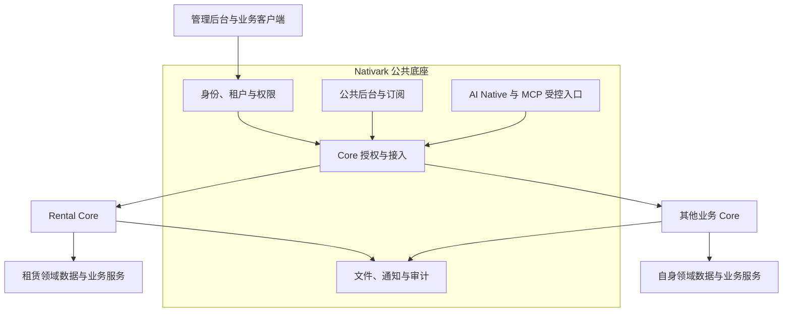

# Nativark

**面向 AI Native 应用的开源 SaaS 底座。**

*An open-source SaaS foundation for AI-native applications.*

Nativark 为开发者和开发 AI 提供构建业务应用所需的公共基础，包括身份认证、多租户、权限、订阅、管理后台和受控 AI 能力。业务通过独立的 **Core** 接入，拥有自己的领域模型、数据、页面和业务规则。

开源主体是 Nativark 底座。**Rental Core 将作为首个开源业务 Core 示范**，展示如何在公共底座上构建完整业务、接入客户端并向 Agent 提供受控工具。后续可按同一接入边界扩展 CRM、TMS 等业务 Core。

当前仓库正在从 Rental OS 组合工程中抽离公共底座。现有开发命令运行底座与 Rental Core 的组合，独立宿主、Core 接入合同和多 Core 授权由平台接入专项推进。源码目录、npm 包名及配置变量目前沿用原工程标识。

- [底座建设范围](#底座建设范围)
- [理解架构](#理解架构)
- [业务 Core 接入](#业务-core-接入)
- [Rental Core 示范](#rental-core-示范)
- [项目组成](#项目组成)
- [本地运行](#本地运行)
- [选择一个开发入口](#选择一个开发入口)
- [验证改动](#验证改动)
- [贡献代码与文档](#贡献代码与文档)
- [部署前检查](#部署前检查)
- [许可证与第三方内容](#许可证与第三方内容)

## 底座建设范围

Nativark 将可复用的 SaaS 能力与行业业务分开维护，使新业务可以复用公共管理、身份和 AI 接入机制。

| 公共能力 | 底座职责 | 业务 Core 职责 |
| --- | --- | --- |
| 身份与多租户 | 账号、会话、租户、组织、角色及可信请求上下文 | 定义业务角色、资源归属和细粒度数据范围 |
| 授权与订阅 | 租户使用权、成员分配、订阅期限、权限校验与撤销 | 声明业务功能及适用的权益、动作前提 |
| 公共管理后台 | 登录、导航容器、主题、语言、公共设置和会话缓存隔离 | 提供业务页面、工作台、对象链接及权限声明 |
| AI Native | 任务编排、模型 Gateway、用量与预算、批准关联、原结果读取与恢复 | 提供可信业务事实、可选工具、业务执行和原操作收据 |
| 基础服务 | 文件存储、通知、审计及事件、作业的公共接点 | 裁定业务文件 ACL、释放字段、消息内容和事件事实 |
| Core 生命周期 | 受控注册、兼容检查、租户授权、成员分配、绑定与停用接点 | 维护领域配置、初始化、迁移、历史读取和在途业务收尾 |

已有公共实现可从当前组合工程中查阅。Core 注册、成员分配、多 Core 隔离及独立运行的实现范围和验收入口由正式接入文档维护。[Core 接入需求](docs/平台底座/Core接入/平台Core接入-需求.md) · [开发任务](docs/平台底座/Core接入/平台Core接入-开发任务.md)

## 理解架构

下图展示抽离后的目标职责关系，实际模块与构建边界随 Core 接入实施逐步落地。



底座管理可信身份、租户和公共授权。每个 Core 定义自己的业务分区、资源与动作，后台页面、API、导出和 AI 工具均按当前授权访问。Rental 的经营空间、品类和地点归 Rental Core 管理，其他 Core 可以采用自己的团队、项目或业务资源模型。

Core 持有业务事实与最终裁定。Agent 通过明确发布的工具读取事实、准备草稿，并在当前权限和必要批准满足后委托 Core 执行。模型调用使用统一 Gateway 和财务预算账，任务累计资源单独记录。结果不明时，通过原操作和原收据核对。

开发 AI 通过正式接口、明确的模块边界、示范代码和可复现验证参与开发。运行中的业务 Agent 按业务工具及当前授权工作。

## 业务 Core 接入

接入设计围绕以下步骤组织，合同与示例代码随实施阶段交付。

1. 开发者声明 Core 标识、实现与合同版本、公共依赖、业务资源、页面和迁移归属。
2. 宿主通过受控构建入口装配 Core，核对命名空间、必需依赖及数据兼容。
3. SaaS 管理员为租户授权使用已注册 Core。
4. 租户管理员从获权集合中给成员分配 Core，再配置适用的业务角色与资源范围。
5. Core 在约定事务内完成业务绑定和初始化，返回可追溯的操作结果。

| 运行组合 | 目标行为 |
| --- | --- |
| 无 Core | 平台可启动、登录和进入公共后台，提示联系管理员授权业务 Core，业务 Agent 随 Core 工具和授权开放 |
| 单 Core | 获权成员使用该 Core 的业务页面、API 和自身数据范围 |
| 多 Core | 同部署、同租户并存多个 Core，各自授权、导航、数据和缓存保持隔离 |
| Core 停用与重开 | 保留原数据、配置、绑定和收据，按当前权限、订阅及依赖恢复，分别处理历史与在途业务 |

Core 的 AI 工具为可选贡献。普通业务通过页面和 API 按权限运行，Agent 查询与操作入口在工具发布后按授权开放。工具的开放范围由发布状态、租户授权、成员使用权、角色、资源范围、AI 政策及必要批准共同决定。租户订阅期限统一管理，各 Core 的开通与停用分别控制。

跨 Core 数据协作将在具体场景中设计受控对象引用、接口和事件，数据由所属 Core 维护。[接口与生命周期设计](docs/平台底座/Core接入/平台Core接入-开发任务.md#contract-design) · [接入指南](docs/平台底座/Core接入/平台Core接入-开发任务.md#integration-guide) · [跨 Core 协作规划](docs/平台底座/未来规划/平台底座-通用化与开源方案.md#cross-core-collaboration)

## Rental Core 示范

Rental Core 是首个业务示范，提供商品、资产、库存、报价、订单、交付、归还、检查和结算等租赁业务。摄影设备、露营装备、车辆载具和工程设备通过品类定义、计费策略及能力扩展共用租赁业务链。

这个示范将展示 Core 如何使用公共身份、租户、后台和 AI 接入机制，同时保有业务模型、事务、金额、幂等与历史快照。客户网站、员工与客户小程序、企业客户门户提供该业务的多端消费样例。

现有实现与业务验收范围沿 Rental 专项维护。开发者可从实际 Controller、领域服务和客户端调用链开始阅读。[Rental Core 需求](<docs/Rental Core/Rental Core-需求.md>) · [品类治理](<docs/Rental Core/品类治理/品类治理-需求.md>) · [业务源码](apps/api/src/modules/rental-core)

## 项目组成

主工程使用 npm workspaces，技术栈为 TypeScript、NestJS 10、React 19 / Vite、UIArc、Prisma 5 和 MySQL。具体依赖版本以包声明和锁文件为准。[根包配置](package.json) · [依赖锁文件](package-lock.json)

| 位置 | 当前内容 | 阅读入口 |
| --- | --- | --- |
| `apps/api` | 身份、公共平台、AI Native、基础服务与现有 Core 的 API 组合 | [启动](apps/api/src/main.ts)、[装配](apps/api/src/app.module.ts) |
| `apps/admin` | SaaS 管理、租户公共后台与现有业务页面 | [入口](apps/admin/src/main.tsx)、[本端规则](apps/admin/AGENTS.md) |
| `packages/shared` | 公共类型、schema、常量和运行时工具 | [正式出口](packages/shared/src/index.ts)、[包配置](packages/shared/package.json) |
| `packages/ui-arc` | 组件源码、来源与许可 | [组件说明](packages/ui-arc/README.md) |
| `packages/mcp-server` | 受控 MCP 传输和工具适配 | [包说明](packages/mcp-server/README.md) |
| `clients/harness-plugin` | Harness 客户端对标准 MCP 的消费 | [插件说明](clients/harness-plugin/README.md) |
| `apps/api/src/modules/rental-core` | 首个业务 Core 的领域实现 | [Rental 专项](<docs/Rental Core/Rental Core-协作接续.md>) |
| `apps/tenant-website`、`apps/enterprise-portal` | Rental 客户网站与企业客户门户 | [客户网站](apps/tenant-website/README.md)、[企业门户](apps/enterprise-portal/README.md) |
| `apps/miniprogram`、`apps/staff-miniprogram` | Rental 客户与员工微信小程序 | [客户小程序](apps/miniprogram/README.md)、[员工小程序](apps/staff-miniprogram/README.md) |
| `tests`、`scripts` | 契约、业务、宿主验证与开发、运维脚本 | [命令清单](package.json) |
| `docs` | 正式需求、任务、阶段记录、接续与公共技术资料 | [文档导航](docs/文档导航.md) |

根构建按 shared → MCP server → API → admin 执行。网站、小程序和 `clients/` 使用各自构建入口。平台营销网站位于 `apps/website` 与 `apps/website-next`，原定制客户端及上游来源保留在 `clients/agent-desktop`。[静态网站](apps/website/README.md) · [Next.js 网站](apps/website-next/README.md) · [保留客户端](clients/agent-desktop/README.md)

## 本地运行

当前步骤运行底座与 Rental Core 的组合工程。准备独立开发数据库后，可以体验公共后台和首个业务示范。无 Core 独立构建和运行由 Core 接入专项交付。

### 1. 环境要求

| 工具 | 要求 |
| --- | --- |
| Node.js | 建议 Node 22 LTS，22.12 或更新补丁，满足当前 Vite 的版本要求 |
| npm | 使用支持根 `package-lock.json` v3 的版本 |
| MySQL | 开发 Compose 使用 MySQL 8.4 |
| Docker Compose | 可选，用于本地 MySQL 和 Redis |
| 微信开发者工具 | 开发 Rental 微信示范端时使用 |

克隆仓库并按锁文件安装依赖。

```bash
git clone https://github.com/JinPen-G/Nativark.git
cd Nativark
npm ci
```

下面的复制命令使用 Bash 写法，PowerShell 可使用 `Copy-Item .env.example .env`。

### 2. 配置独立环境

在新克隆的目录中复制配置模板，并填写自己的开发配置。

```bash
cp .env.example .env
```

| 配置 | 用途 |
| --- | --- |
| `DATABASE_URL` | 独立开发 MySQL 的连接串 |
| `PLATFORM_DATA_SOURCE`、`RENTAL_OS_DATA_SOURCE`、`INFRA_DATA_SOURCE` | 持久化开发使用 `mysql` |
| `AUTH_TOKEN_SECRET`、`INTEGRATION_ENCRYPTION_KEY` | 自行生成的认证与集成加密密钥 |
| `MYSQL_ROOT_PASSWORD`、`MYSQL_PASSWORD` | Compose 初始化 MySQL 所用口令 |
| `MYSQL_DATABASE`、`MYSQL_USER` | Compose 的库名与应用账号，默认 `rental_os` |
| `SEED_PLATFORM_PASSWORD`、`SEED_DEMO_PASSWORD` | 执行示范 Seed 时设置的平台和演示租户管理员口令 |
| `NODE_ENV`、`RENTAL_DEPLOYMENT_PROFILE` | 本地开发均设为 `development` |
| `API_PORT` | API 端口，默认 3000 |
| `API_PROXY_TARGET`、`VITE_API_BASE_URL` | 管理后台代理目标与公开 API 基址，同源 API 基址使用 `/api` |

服务端与 Web 配置通过统一环境模块加载。进程变量优先，`RENTAL_ENV_FILE` 可指定外部配置文件，Docker Compose 对应使用 `--env-file`。密钥由服务端配置持有，Web 只接收公开字段，公开字段变化后需重新构建。[配置模板](.env.example) · [环境加载实现](config/environment.cjs)

### 3. 初始化开发数据库

使用 Compose 时启动本地 MySQL。

```bash
docker compose up -d mysql
```

然后构建共享运行时、生成 Prisma Client 并应用已有迁移。

```bash
npm run build -w @rental-os/shared
npm run db:generate
npm run db:migrate:deploy
```

配置两项 Seed 口令后，建立平台账号、示范租户及基础配置。

```bash
npm run db:seed
```

重复 Seed 会更新示范账号、角色和配置，请在自己的开发库使用。新增迁移、已有库升级与恢复流程见数据库指南。[Compose 配置](docker-compose.yml) · [数据库指南](docs/公共技术资料/开发指南/数据库-启动指南.md)

### 4. 启动 API 与管理后台

```bash
npm run dev
```

该命令先构建 shared 和 MCP server，再启动 API watch 与管理后台 Vite。

| 入口 | 默认地址 |
| --- | --- |
| 管理后台 | `http://127.0.0.1:5175` |
| API | `http://localhost:3000/api` |
| 健康响应 | `http://localhost:3000/api/health` |
| OpenAPI | `http://localhost:3000/api/openapi.json` |

API 与后台也可分别通过 `npm run dev:api`、`npm run dev:admin` 启动。使用 Seed 中自己设置的账号口令登录对应平台或示范租户。支付、短信、对象存储、微信与模型服务按所需场景配置及验证。

其他示范客户端的运行方式见各自 README，详细架构与环境约束见公共指南。[项目开发指南](docs/公共技术资料/开发指南/项目-开发指南.md)

## 选择一个开发入口

开发 Agent 可以从统一能力索引查找组件、公共导出、页面和 API，再沿结果中的源码与资料链接继续阅读。准备依赖并构建 `@rental-os/core-contracts` 后，运行 `node packages/core-contracts/dist/capabilities.js --query SaveButton --json` 查询现有保存按钮，替换关键词可查其他能力。扫描读取当前检出的正式声明，支持分类和分页。[能力查询用法](packages/core-contracts/README.md#找到平台已有的功能)

| 开发内容 | 实际入口 | 需要同时核对 |
| --- | --- | --- |
| 公共身份、租户与权限 | [Auth](apps/api/src/modules/auth/auth.service.ts)、[Guard](apps/api/src/common/api-auth.guard.ts)、[请求上下文](apps/api/src/common/request-identity.ts)、[平台服务](apps/api/src/modules/platform/platform.service.ts) | 当前身份、角色、租户及业务范围、会话撤销、审计 |
| Core 接入与底座抽离 | [接入需求](docs/平台底座/Core接入/平台Core接入-需求.md)、[接口设计](docs/平台底座/Core接入/平台Core接入-开发任务.md#contract-design) | 数据所有者、正式出口、版本、构建组合和初始化事务 |
| 管理后台与页面接入 | [后台规则](apps/admin/AGENTS.md)、[导航](apps/admin/src/app/navigation.tsx)、[路由](apps/admin/src/app/AppRouter.tsx) | 服务端授权、主题与语言、空错态、请求与缓存隔离 |
| 公共 API 与运行时契约 | [shared 出口](packages/shared/src/index.ts)、[OpenAPI](apps/api/src/contracts/openapi-document.ts) | DTO、schema、生产者、各端消费者及产物版本 |
| AI Native | [专项入口](<docs/AI Native/AI Native-协作接续.md>)、[应用组合](apps/api/src/modules/ai-native/ai-native-application.providers.ts) | 工具发布、当前权限、Gateway、预算、批准与原收据 |
| Rental 业务示范 | [Core 源码](apps/api/src/modules/rental-core)、[业务需求](<docs/Rental Core/Rental Core-需求.md>) | 业务规则、历史快照、库存与金额、幂等及事务 |
| 外部 Agent 客户端 | [MCP](docs/MCP服务/MCP服务-协作接续.md)、[Harness](docs/Harness插件/Harness插件-协作接续.md) | 原身份、目标授权、数据投影和工具可用性 |

阅读一项功能时，沿页面或调用方 → API 封装 → Controller / Guard → 应用与领域服务 → 仓储 / 外部适配 → 原结果读取追踪。

## 验证改动

按实际改动选择验证入口，并先查看脚本的读写和环境依赖。

| 验证内容 | 入口 | 证据范围 |
| --- | --- | --- |
| 文档 | `npm run docs:check` | 白名单文档链接、共用入口和 AI Native 任务表算术 |
| 文档检查器 | `npm run test:docs` | 检查规则自身的回归 |
| 公共接口 | `npm run contract:validate` | Controller、OpenAPI、DTO、路由权限和客户写入归属的静态一致性 |
| 后台结构 | `npm run test:admin` | 后台约定与结构检查 |
| 类型与主工程构建 | `npm run lint`、`npm run build` | 按实际包依赖检查类型并编译 shared、MCP、API、admin |
| Rental 示范业务 | `npm run test:rental-core`、`npm run test:pricing-strategy` | 原 Core 和计费策略的定向行为 |

类型、静态、离线行为、构建、浏览器或微信宿主、真实数据库、外部服务与发布证据分别记录。数据库及供应商测试按对应专项准备独立环境。一次性验证产物集中管理，退出时完成清理。命令与隔离约束沿公共规则查阅。[脚本清单](package.json) · [验证与临时产物规则](AGENTS.md#修改验证与交付)

## 贡献代码与文档

欢迎围绕公共底座、Core 接入和示范业务贡献代码。新能力先明确归属、接口与验收范围，再从实际调用链实现一个完整功能阶段。

- 从文档导航阅读对应需求、任务和当前接续，核对工作树与文件归属。
- 公共协议通过正式包出口复用，接口变更同步生产者、DTO / OpenAPI 和直接消费者。
- 关键文件用简短说明表达职责与限制，复杂事务、并发和恢复逻辑解释实现原因。
- 完成必要验证后，记录命令、结果、固定版本和剩余问题，提交范围清晰的改动。

每个正式专项的文档按四册维护。

| 文档 | 职责 |
| --- | --- |
| `主题-需求.md` | 产品范围、业务规则和验收依据 |
| `主题-开发任务.md` | 固定任务、依赖、实施要求与有证据的进度 |
| `主题-开发记录.md` | 功能阶段的实现、验证、问题及来源 |
| `主题-协作接续.md` | 当前目标、写入归属、未完成项和下一入口 |

开发 AI 与人类贡献者使用相同的项目规则，必要的源码说明与文档随实现更新。历史原文通过固定 Git 版本或专项归档保留。[文档导航](docs/文档导航.md) · [共用开发规则](AGENTS.md) · [Claude 入口](CLAUDE.md)

## 部署前检查

正式部署需为选定的底座和 Core 组合核定以下内容。

- 可复现构建、运行依赖、Core 与合同版本、当前授权及历史读取兼容。
- 真实环境配置、数据库迁移与备份、恢复演练、权限与数据范围。
- 已启用供应商的真实调用、原操作核对、日志脱敏和维护责任。
- 发行包的第三方许可、来源文件和素材分发范围。

部署、备份与恢复操作沿目标环境和既有脚本办理。安全问题通过维护者确认的私密渠道报告，材料先脱敏。[运维脚本](scripts/ops) · [数据库与恢复指南](docs/公共技术资料/开发指南/数据库-启动指南.md)

## 许可证与第三方内容

Nativark 自有源码及相关文档采用 MIT License，允许使用、修改、分发和商业使用。分发时须保留版权与许可证声明。[MIT 许可证](LICENSE)

引用的组件、客户端源码和素材按各自许可及来源声明使用，随发行包保留对应版权与许可文件。

- UIArc 组件按其来源与许可使用。[UIArc 许可](packages/ui-arc/LICENSE) · [来源说明](packages/ui-arc/README.md)
- Animate UI 等保留组件的许可随对应源码维护。[侧栏许可](apps/admin/src/components/animate-sidebar/LICENSE.md) · [组件来源](apps/admin/src/components/animate-sidebar/README.md)
- 原定制客户端中的上游 Harness 按原许可和第三方声明使用。[上游许可](clients/agent-desktop/harness/LICENSE) · [第三方声明](clients/agent-desktop/harness/THIRD_PARTY_NOTICES.md) · [来源记录](clients/agent-desktop/UPSTREAM.json)
- 网站图片、字体、标志与动画的使用范围沿素材来源核定。[网站说明](apps/website/README.md)
