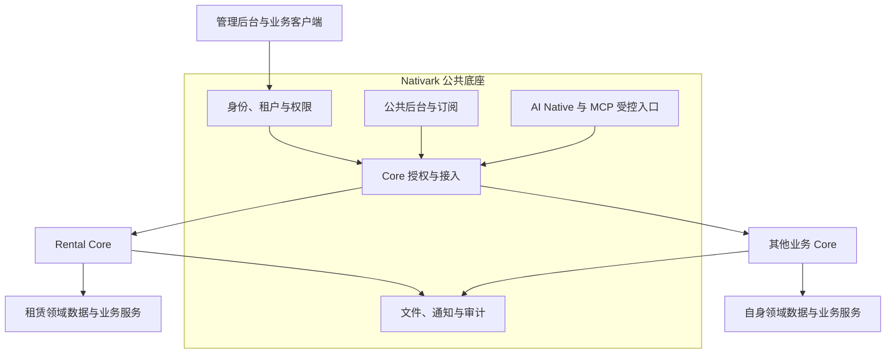

# Nativark

**面向 AI Native 应用的开源 SaaS 底座。**

*An open-source SaaS foundation for AI-native applications.*

Nativark 为开发者和开发 AI 提供构建业务应用所需的公共基础，包括身份认证、多租户、权限、订阅、管理后台和受控 AI 能力。业务通过独立的 **Core** 接入，拥有自己的领域模型、数据、页面和业务规则。

开源主体是 Nativark 底座。**[Rental Core](https://github.com/JinPen-G/nativark-rental-core) 是首个独立开源业务 Core 示范**，展示如何在公共底座上构建完整业务、接入客户端并向 Agent 提供受控工具。后续可按同一接入边界扩展 CRM、TMS 等业务 Core。

公共底座、Rental Core 和宿主装配分别维护。默认公共 API 与后台提供初始化、认证、租户 / 人员角色 / 组织管理、安全与外观设置、订阅、字典与编号、成员邀请和邮件目录；业务 Core 由宿主显式选择。Rental 示范提供独立 API、各端页面与客户端，可另外选择 AI Native 组合。原 Rental OS 开发入口继续消费这些包的同一实现。源码目录、npm 包名及配置变量沿用原工程标识。[独立公共 API](apps/platform-api/README.md) · [公共后台](apps/platform-admin/README.md) · [Rental 宿主](apps/rental-api/README.md)

- [底座建设范围](#底座建设范围)
- [理解架构](#理解架构)
- [单独取出底座源码](#单独取出底座源码)
- [业务 Core 接入](#业务-core-接入)
- [Rental Core 示范](#rental-core-示范)
- [项目组成](#项目组成)
- [本地运行](#本地运行)
- [选择一个开发入口](#选择一个开发入口)
- [验证改动](#验证改动)
- [贡献代码与文档](#贡献代码与文档)
- [部署前检查](#部署前检查)
- [许可证与第三方内容](#许可证与第三方内容)

## 底座建设范围

Nativark 将可复用的 SaaS 能力与行业业务分开维护，使新业务可以复用公共管理、身份和 AI 接入机制。

| 公共能力 | 底座职责 | 业务 Core 职责 |
| --- | --- | --- |
| 身份与多租户 | 账号、会话、租户、组织、角色及可信请求上下文 | 定义业务角色、资源归属和细粒度数据范围 |
| 授权与订阅 | 租户使用权、成员分配、订阅期限、权限校验与撤销 | 声明业务功能及适用的权益、动作前提 |
| 公共管理后台 | 登录、导航容器、主题、语言、公共设置和会话缓存隔离 | 提供业务页面、工作台、对象链接及权限声明 |
| AI Native | 任务编排、模型 Gateway、用量与预算、批准关联、原结果读取与恢复 | 提供可信业务事实、可选工具、业务执行和原操作收据 |
| 基础服务 | 文件存储、通知、审计及事件、作业的公共接点 | 裁定业务文件 ACL、释放字段、消息内容和事件事实 |
| Core 生命周期 | 受控注册、兼容检查、租户授权、成员分配、绑定与停用接点 | 维护领域配置、初始化、迁移、历史读取和在途业务收尾 |

公共实现可从[平台服务](packages/platform-server/README.md)、[公共后台](packages/platform-admin/README.md)和[公共契约](packages/platform-contracts/README.md)查阅。开发新业务Core先读[五步接入手册与Agent模板](packages/core-contracts/README.md#五步快速接入)，再按需查看真实工单示例及公共模块。

## 理解架构

下图展示公共底座与业务 Core 的职责关系，实际构建和数据选择见各宿主说明。



底座管理可信身份、租户和公共授权。每个 Core 定义自己的业务分区、资源与动作，后台页面、API、导出和 AI 工具均按当前授权访问。Rental 的经营空间、品类和地点归 Rental Core 管理，其他 Core 可以采用自己的团队、项目或业务资源模型。

Core 持有业务事实与最终裁定。Agent 通过明确发布的工具读取事实、准备草稿，并在当前权限和必要批准满足后委托 Core 执行。模型调用使用统一 Gateway 和财务预算账，任务累计资源单独记录。结果不明时，通过原操作和原收据核对。

开发 AI 通过正式接口、明确的模块边界、示范代码和可复现验证参与开发。运行中的业务 Agent 按业务工具及当前授权工作。

## 单独取出底座源码

从已提交版本可生成只包含公共 API、公共后台和平台依赖的源码包，根构建与锁文件会使用公共闭包。解包后的默认工程不包含 Rental Core，接入自己的业务从同一份 Core 手册开始。导出命令、来源摘要和初始化步骤见[底座源码发行说明](packages/core-contracts/README.md#单独取出底座源码)。

## 业务 Core 接入

Core 通过正式清单、合同和受控宿主接入，按以下步骤使用。

1. 开发者声明 Core 标识、实现与合同版本、公共依赖、业务资源、页面和迁移归属。
2. 宿主通过受控构建入口装配 Core，核对命名空间、必需依赖及数据兼容。
3. SaaS 管理员为租户授权使用已注册 Core。
4. 租户管理员从获权集合中给成员分配 Core，再配置适用的业务角色与资源范围。
5. Core 在约定事务内完成业务绑定和初始化，返回可追溯的操作结果。

| 运行组合 | 目标行为 |
| --- | --- |
| 无 Core | 平台可启动、登录和进入公共后台，提示联系管理员授权业务 Core，业务 Agent 随 Core 工具和授权开放 |
| 单 Core | 获权成员使用该 Core 的业务页面、API 和自身数据范围 |
| 多 Core | 同部署、同租户并存多个 Core，各自授权、导航、数据和缓存保持隔离 |
| Core 停用与重开 | 保留原数据、配置、绑定和收据，按当前权限、订阅及依赖恢复，分别处理历史与在途业务 |

Core 的 AI 工具为可选贡献。普通业务通过页面和 API 按权限运行，Agent 查询与操作入口在工具发布后按授权开放。工具的开放范围由发布状态、租户授权、成员使用权、角色、资源范围、AI 政策及必要批准共同决定。租户订阅期限统一管理，各 Core 的开通与停用分别控制。

跨 Core 数据协作将在具体场景中设计受控对象引用、接口和事件，数据由所属 Core 维护。

SaaS 管理区的 Core 包管理页提供注册目录、GitHub Topic 发现和独立版本视图。管理员选择固定发行或已下载包，沿同一校验链预览并准备安装、底座更新或单 Core 更新；结果保留为待部署，随后按固定材料办理构建、迁移和注册，再分别授权租户与成员。[Core 包管理与宿主接入](packages/platform-core-host/README.md#core-包管理接入) · [后台操作说明](packages/platform-admin/src/features/core-packages/README.md)

## Rental Core 示范

Rental Core 是首个业务示范，提供商品、资产、库存、报价、订单、交付、归还、检查和结算等租赁业务。摄影设备、露营装备、车辆载具和工程设备通过品类定义、计费策略及能力扩展共用租赁业务链。

这个示范使用公共身份、租户、后台和 AI 接入机制，同时保有业务模型、事务、金额、幂等与历史快照。客户网站、员工与客户小程序、企业客户门户提供该业务的多端消费样例。源码与标准包在[独立 Rental Core 仓库](https://github.com/JinPen-G/nativark-rental-core)发布，固定发行从 [GitHub Releases](https://github.com/JinPen-G/nativark-rental-core/releases)获取，沿[公开 Core 发现与包准备](packages/core-contracts/README.md#发现公开-core-仓库)接入。

开发者可从实际 Controller、领域服务和客户端调用链开始阅读。[业务包与接入说明](packages/rental-core/README.md)

## 项目组成

主工程使用 npm workspaces，技术栈为 TypeScript、NestJS 10、React 19 / Vite、UIArc、Prisma 5 和 MySQL。具体依赖版本以包声明和锁文件为准。[根包配置](package.json) · [依赖锁文件](package-lock.json)

| 位置 | 当前内容 | 阅读入口 |
| --- | --- | --- |
| `apps/api` | 身份、公共平台、AI Native、基础服务与现有 Core 的 API 组合；业务及支付 HTTP 通过 Rental 正式模块挂载 | [启动](apps/api/src/main.ts)、[装配](apps/api/src/app.module.ts)、[同一服务组](apps/api/src/application-services.module.ts) |
| `apps/platform-api` | 默认无 Core 的独立公共 API，提供初始化 / 认证 / 公共管理 / 组织与安全 / 订阅及数据准备 | [宿主导读](apps/platform-api/README.md) |
| `apps/example-tickets-api` | 公共底座与单工单Core受控组合，消费固定标准包、公共身份和同一迁移准备链 | [示范导读](apps/example-tickets-api/README.md) |
| `apps/rental-api` | 公共底座与 Rental 的独立组合；共用同一身份、数据库与业务实例，提供常规及可选 AI 的构建、启动和数据准备入口 | [Rental组合导读](apps/rental-api/README.md) |
| `packages/platform-contracts` | 无行业依赖的公共身份、人员与设置合同；原 shared 兼容再导出 | [正式出口](packages/platform-contracts/README.md) |
| `packages/platform-server` | 认证、公共管理与订阅、字典/编号、集成、文件原语及公共 HTTP 的唯一实现，存储由宿主提供 | [源码路线](packages/platform-server/README.md) |
| `packages/platform-core-host` | 真实公共身份、标准Core授权/绑定、目录/范围与HTTP的单源适配 | [接入路线](packages/platform-core-host/README.md) |
| `packages/platform-admin` | 公共后台外壳、UIArc、组织/安全/订阅/集成/工具设置与 Core 页面适配，原后台窄转接同一实现 | [公共前端导读](packages/platform-admin/README.md) |
| `packages/ai-native-server` | 已支持 AI Runtime、任务与恢复、Gateway 和原权限事务的单源实现，由选用 AI 的宿主装配 | [AI 服务端导读](packages/ai-native-server/README.md) |
| `packages/ai-native-data` | 可选 AI 数据、原迁移字节及物理观察贡献，与所属宿主的所选 Client 和部署锁一致 | [AI 数据导读](packages/ai-native-data/README.md) |
| `apps/platform-admin` | 默认无Core的公共Web宿主，提供登录/改密、公共管理、组织/安全/订阅与集成设置及完整后台外壳 | [公共后台导读](apps/platform-admin/README.md) |
| `apps/example-tickets-admin` | 复用同一公共应用的工单Web宿主，四页声明接线与标准包构建核验 | [工单后台导读](apps/example-tickets-admin/README.md) |
| `apps/example-multi-core-admin` | Rental与工单共用一份公共应用、会话和查询缓存，各自按当前授权显示页面与业务范围 | [双Core后台导读](apps/example-multi-core-admin/README.md) |
| `apps/admin` | SaaS 管理、租户公共后台与现有业务页面 | [入口](apps/admin/src/main.tsx)、[本端规则](apps/admin/AGENTS.md) |
| `packages/rental-core` | 租赁领域合同、规则、服务、仓储、HTTP及各端贡献；原各端消费同一实现，独立宿主按标准包与部署锁装配 | [Rental包导读](packages/rental-core/README.md) · [会员与客户](packages/rental-core/admin/membership/README.md) · [工作台与报表](packages/rental-core/admin/operations/README.md) · [渠道](packages/rental-core/admin/channels/README.md) · [开业](packages/rental-core/admin/setup/README.md) |
| `packages/shared` | 既有各端合同兼容总出口，公共和Rental单源分别来自各自包 | [正式出口](packages/shared/src/index.ts)、[包配置](packages/shared/package.json) |
| `packages/ui-arc` | 组件源码、来源与许可 | [组件说明](packages/ui-arc/README.md) |
| `packages/mcp-server` | 受控 MCP 传输和工具适配 | [包说明](packages/mcp-server/README.md) |
| `packages/rental-mcp-host` | 显式选装的 Rental OAuth、Web 控制面、原读取与事务审计参加者，旧组合路径消费相同实现 | [原宿主接入](packages/rental-mcp-host/README.md) · [独立启动](apps/rental-api/src/mcp-bootstrap.ts) |
| `clients/harness-plugin` | Harness 客户端对标准 MCP 的消费 | [插件说明](clients/harness-plugin/README.md) |
| `apps/api/src/modules/rental-core` | 旧组合宿主的兼容入口，转接 Rental 包中的同一领域实现 | [业务包](packages/rental-core/README.md) |
| `apps/tenant-website`、`apps/enterprise-portal` | Rental 客户网站与企业客户门户 | [客户网站](apps/tenant-website/README.md)、[企业门户](apps/enterprise-portal/README.md) |
| `packages/rental-core/clients/enterprise-portal` | 完整企业门户业务前端；原门户宿主复用公共UI并消费正式页面出口 | [门户接入](packages/rental-core/clients/enterprise-portal/README.md) |
| `packages/rental-core/clients/website-ui` | 完整客户网站业务前端；原网站薄宿主供给同一客户会话、公开配置和资产 | [网站接入](packages/rental-core/clients/website-ui/README.md) |
| `apps/miniprogram`、`apps/staff-miniprogram` | Rental 客户与员工微信小程序 | [客户小程序](apps/miniprogram/README.md)、[员工小程序](apps/staff-miniprogram/README.md) |
| `tests`、`scripts` | 契约、业务、宿主验证与开发、运维脚本 | [命令清单](package.json) |

根构建按 shared → MCP server → API → admin 执行。网站、小程序和 Harness 插件使用各自构建入口。[静态网站](apps/website/README.md) · [Next.js 网站](apps/website-next/README.md) · [Harness 插件](clients/harness-plugin/README.md)

## 本地运行

只使用公共底座时，按[公共 API 初始化与构建](apps/platform-api/README.md)及[公共后台](apps/platform-admin/README.md)准备自己的数据库和配置；业务 Core 的源码、表和作业不作为公共登录的前置。接入新 Core 从[五步手册](packages/core-contracts/README.md#五步快速接入)开始。

下面保留原底座与 Rental Core 组合工程的开发步骤。Rental 独立宿主的首次 schema 选择、专属 Client、常规或可选 AI 构建和固定部署包见[示范宿主](apps/rental-api/README.md)及[Core 构建说明](packages/rental-core/README.md#使用与构建)。运行与持久化验收分别记录。

### 1. 环境要求

| 工具 | 要求 |
| --- | --- |
| Node.js | 建议 Node 22 LTS，22.12 或更新补丁，满足当前 Vite 的版本要求 |
| npm | 使用支持根 `package-lock.json` v3 的版本 |
| MySQL | 开发 Compose 使用 MySQL 8.4 |
| Docker Compose | 可选，用于本地 MySQL 和 Redis |
| 微信开发者工具 | 开发 Rental 微信示范端时使用 |

克隆仓库并按锁文件安装依赖。

```bash
git clone https://github.com/JinPen-G/Nativark.git
cd Nativark
npm ci
```

下面的复制命令使用 Bash 写法，PowerShell 可使用 `Copy-Item .env.example .env`。

### 2. 配置独立环境

在新克隆的目录中复制配置模板，并填写自己的开发配置。

```bash
cp .env.example .env
```

| 配置 | 用途 |
| --- | --- |
| `DATABASE_URL` | 独立开发 MySQL 的连接串 |
| `PLATFORM_DATA_SOURCE`、`RENTAL_OS_DATA_SOURCE`、`INFRA_DATA_SOURCE` | 持久化开发使用 `mysql` |
| `AUTH_TOKEN_SECRET`、`INTEGRATION_ENCRYPTION_KEY` | 自行生成的认证与集成加密密钥 |
| `MYSQL_ROOT_PASSWORD`、`MYSQL_PASSWORD` | Compose 初始化 MySQL 所用口令 |
| `MYSQL_DATABASE`、`MYSQL_USER` | Compose 的库名与应用账号，默认 `rental_os` |
| `SEED_PLATFORM_PASSWORD`、`SEED_DEMO_PASSWORD` | 执行示范 Seed 时设置的平台和演示租户管理员口令 |
| `NODE_ENV`、`RENTAL_DEPLOYMENT_PROFILE` | 本地开发均设为 `development` |
| `API_PORT` | API 端口，默认 3000 |
| `API_PROXY_TARGET`、`VITE_API_BASE_URL` | 管理后台代理目标与公开 API 基址，同源 API 基址使用 `/api` |

服务端与 Web 配置通过统一环境模块加载。进程变量优先，`RENTAL_ENV_FILE` 可指定外部配置文件，Docker Compose 对应使用 `--env-file`。密钥由服务端配置持有，Web 只接收公开字段，公开字段变化后需重新构建。[配置模板](.env.example) · [环境加载实现](config/environment.cjs)

### 3. 初始化开发数据库

使用 Compose 时启动本地 MySQL。

```bash
docker compose up -d mysql
```

然后生成所选schema的 Prisma Client，构建共享运行时并应用已有迁移。

```bash
npm run db:generate
npm run build -w @rental-os/shared
npm run db:migrate:deploy
```

配置两项 Seed 口令后，建立平台账号、示范租户及基础配置。

```bash
npm run db:seed
```

重复 Seed 会更新示范账号、角色和配置，请在自己的开发库使用。[Compose 配置](docker-compose.yml) · [数据库迁移](apps/api/prisma/migrations)

### 4. 启动 API 与管理后台

旧组合宿主使用自己按上一节生成的原 Client。先显式指定它，供 Rental 和 AI 包的构建前置共用；PowerShell 在仓库根执行：

```powershell
$env:RENTAL_PRISMA_CLIENT = (Resolve-Path 'node_modules/.prisma/client/index.d.ts').Path
$env:RENTAL_PRISMA_LEGACY = '1'
```

独立公共或 Rental 宿主使用各自 `generated/client/index.d.ts`，并清除上述 legacy 选择。所选编译器核声明与同目录 schema，缺失、错模式或冲突会给出错误。[Client 选择规则](scripts/build-selected-prisma.cjs)

```bash
npm run dev
```

该命令先构建 shared 和 MCP server，再启动 API watch 与管理后台 Vite。

| 入口 | 默认地址 |
| --- | --- |
| 管理后台 | `http://127.0.0.1:5175` |
| API | `http://localhost:3000/api` |
| 健康响应 | `http://localhost:3000/api/health` |
| OpenAPI | `http://localhost:3000/api/openapi.json` |

API 与后台也可分别通过 `npm run dev:api`、`npm run dev:admin` 启动。使用 Seed 中自己设置的账号口令登录对应平台或示范租户。支付、短信、对象存储、微信与模型服务按所需场景配置及验证。

其他示范客户端的运行方式见[项目组成](#项目组成)列出的各端 README。

## 选择一个开发入口

开发 Agent 可以从统一能力索引查找组件、公共导出、页面和 API，再沿结果中的源码与资料链接继续阅读。准备依赖并构建 `@rental-os/core-contracts` 后，运行 `node packages/core-contracts/dist/capabilities.js --query SaveButton --json` 查询现有保存按钮，替换关键词可查其他能力。扫描读取当前检出的正式声明，支持分类和分页。[能力查询用法](packages/core-contracts/README.md#找到平台已有的功能)

| 开发内容 | 实际入口 | 需要同时核对 |
| --- | --- | --- |
| 公共身份、租户与权限 | [认证](packages/platform-server/src/modules/auth/platform-auth.service.ts)、[公共Guard](packages/platform-server/src/platform-auth.guard.ts)、[请求上下文](packages/platform-server/src/common/request-identity.ts)、[平台服务导读](packages/platform-server/README.md) | 当前身份、角色、租户及业务范围、会话撤销、审计；原组合兼容入口继续沿同一实现 |
| Core 接入与底座抽离 | [公共Core应用](packages/platform-core-host/src/platform-core-application.ts)、[公共宿主](apps/platform-api/src/app.module.ts)、[正式合同](packages/core-contracts/README.md) | 数据所有者、正式出口、版本、构建组合和初始化事务 |
| 管理后台与页面接入 | [公共应用](packages/platform-admin/src/application.tsx)、[Core路由](packages/platform-admin/src/core/CoreRoutes.tsx)、[页面接入手册](packages/platform-admin/src/core/README.md)、[后台规则](apps/admin/AGENTS.md) | 服务端授权、主题与语言、空错态、请求与缓存隔离 |
| 公共 API 与运行时契约 | [公共合同](packages/platform-contracts/README.md)、[公共OpenAPI](packages/platform-server/src/platform-openapi.ts)、[Core HTTP合同](packages/core-contracts/README.md#登记core的http政策)、[shared兼容出口](packages/shared/src/index.ts) | DTO、schema、生产者、各端消费者及产物版本 |
| AI Native | [服务端导读](packages/ai-native-server/README.md)、[选装AI组合](apps/rental-api/src/ai-composition.ts) | 工具发布、当前权限、Gateway、预算、批准与原收据；当前组合使用明确所选数据与业务参加者 |
| Rental 业务示范 | [领域应用](packages/rental-core/src/application.ts)、[HTTP组合](packages/rental-core/src/application-http.ts)、[独立宿主](apps/rental-api/src/assembly.ts) | 业务规则、历史快照、库存与金额、幂等及事务 |
| 外部 Agent 客户端 | [MCP 服务](packages/mcp-server/README.md)、[Harness 插件](clients/harness-plugin/README.md) | 原身份、目标授权、数据投影和工具可用性 |

阅读一项功能时，沿页面或调用方 → API 封装 → Controller / Guard → 应用与领域服务 → 仓储 / 外部适配 → 原结果读取追踪。

## 验证改动

按实际改动选择验证入口，并先查看脚本的读写和环境依赖。

| 验证内容 | 入口 | 证据范围 |
| --- | --- | --- |
| 本地维护文档 | `npm run docs:check` | 维护者工作区具备内部文档时执行 |
| 文档检查器 | `npm run test:docs` | 检查规则自身的回归 |
| 公共接口 | `npm run contract:validate` | Controller、OpenAPI、DTO、路由权限和客户写入归属的静态一致性 |
| 后台结构 | `npm run test:admin` | 后台约定与结构检查 |
| 固定 Rental 发行与客户端消费 | [发行核验](scripts/verify-rental-distribution.cjs)，用 `--commit <完整SHA>` 选择版本 | 标准归档、安装准备、可选AI数据及五端消费只驻内存 |
| 所选 Prisma 源码类型 | [内存类型入口](scripts/check-selected-prisma-types.cjs)，`--mode platform`、`rental` 或 `rental-ai` | 只读原 Prisma 5.22 官方生成器，在内存检查所选组合；支持 `--config` 指定宿主配置、`--deps` 指定只读依赖 |
| 首次所选 schema 与正式包编译 | `npm run prepare:prisma:schema -- --mode <模式> --output <新目录绝对路径>`；[所选 Client 编译器](scripts/build-selected-prisma.cjs) | schema 准备不依赖业务 dist；正式编译使用宿主已生成的同一 Client，不自动生成或连接数据库 |
| 独立 Rental 部署包 | `npm run package:rental-host -- <明确的包、部署、Client 与输出参数>`，参数见[构建说明](packages/rental-core/README.md#使用与构建) | 固定 Linux Docker 上下文；打包结果分别标明镜像未构建和部署待办理 |
| 类型与主工程构建 | `npm run lint`、`npm run build` | 按实际包依赖检查类型并编译 shared、MCP、API、admin |
| Rental 示范业务 | `npm run test:rental-core`、`npm run test:pricing-strategy` | 原 Core 和计费策略的定向行为 |

接口扫描从实际 AppModule 的 Nest 登记读取路由，支持继承和动态装饰器，未声明的包出口拒绝。已有依赖环境可运行 `node scripts/validate-api-contracts.cjs --offline-prisma` 在内存提供原官方 Prisma 5.22 元数据；此入口不创建 Client 实例、启动服务或连接数据库。[扫描实现](scripts/controller-sources.cjs)

类型、静态、离线行为、构建、浏览器或微信宿主、真实数据库、外部服务与发布证据分别记录。数据库及供应商测试按对应专项准备独立环境。一次性验证产物集中管理，退出时完成清理。命令与隔离约束沿公共规则查阅。[脚本清单](package.json) · [验证与临时产物规则](AGENTS.md#修改验证与交付)

## 贡献代码与文档

欢迎围绕公共底座、Core 接入和示范业务贡献代码。新能力先明确归属、接口与验收范围，再从实际调用链实现一个完整功能阶段。

- 从相关模块入口核对工作树、文件归属与验证方式。
- 公共协议通过正式包出口复用，接口变更同步生产者、DTO / OpenAPI 和直接消费者。
- 关键文件用简短说明表达职责与限制，复杂事务、并发和恢复逻辑解释实现原因。
- 完成必要验证后，记录命令、结果、固定版本和剩余问题，提交范围清晰的改动。

开源贡献的使用说明随对应源码维护。仓库根目录 `docs/` 为维护者私有开发资料，仅在本地保存，排除在提交与发行范围之外。[共用开发规则](AGENTS.md) · [Claude 入口](CLAUDE.md)

## 部署前检查

正式部署需为选定的底座和 Core 组合核定以下内容。

- 可复现构建、运行依赖、Core 与合同版本、当前授权及历史读取兼容。
- 真实环境配置、数据库迁移与备份、恢复演练、权限与数据范围。
- 已启用供应商的真实调用、原操作核对、日志脱敏和维护责任。
- 发行包的第三方许可、来源文件和素材分发范围。

部署、备份与恢复操作沿目标环境和既有脚本办理。安全问题通过维护者确认的私密渠道报告，材料先脱敏。[运维脚本](scripts/ops)

## 许可证与第三方内容

Nativark 公开发布的自有源码及配套使用说明采用 MIT License，允许使用、修改、分发和商业使用。分发时须保留版权与许可证声明。[MIT 许可证](LICENSE)

引用的组件、客户端源码和素材按各自许可及来源声明使用，随发行包保留对应版权与许可文件。

- UIArc 组件按其来源与许可使用。[UIArc 许可](packages/ui-arc/LICENSE) · [来源说明](packages/ui-arc/README.md)
- Animate UI 等保留组件的许可随对应源码维护。[侧栏许可](packages/platform-admin/src/components/animate-sidebar/LICENSE.md) · [组件来源](apps/admin/src/components/animate-sidebar/README.md)
- 网站图片、字体、标志与动画的使用范围沿素材来源核定。[网站说明](apps/website/README.md)
