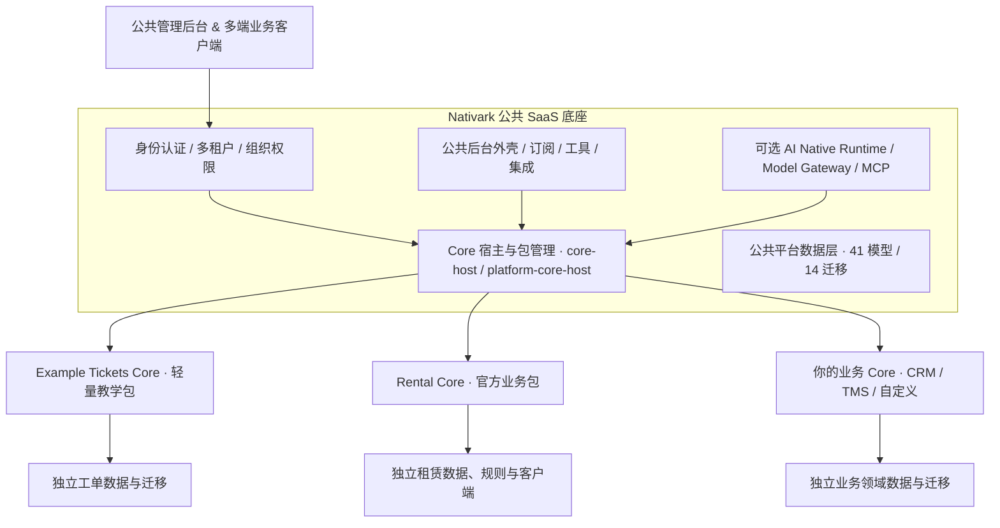

# Nativark

**面向 AI Native 应用的开源多租户 SaaS 底座。**

*An open-source, multi-tenant SaaS foundation built for AI-native business applications.*

[](LICENSE)
[](package.json)
[](package.json)
[](tsconfig.base.json)
[](apps/platform-api/README.md)
[](apps/platform-admin/README.md)
[](apps/platform-api/README.md)

---

**Nativark** 是一个可独立运行的开源多租户 SaaS 底座。它把几乎所有企业级 SaaS 都要重复建设的底层能力——身份认证、多租户与组织权限、SaaS 订阅、公共管理后台、加密外部集成、受控 AI Native / MCP 引擎，以及标准化的 **Core 插件化接入与独立升级机制**——沉淀为纯净的公共平台。

业务系统通过独立的 **Core（业务包）** 接入底座，各自维护领域模型、数据迁移、页面贡献与可选 AI 工具。**底座默认零 Core 即可独立启动、打包与源码导出**；仓库随附轻量教学包 **Example Tickets Core** 与首个官方生产级业务包 **[Rental Core](#内置业务-core-示例)**（同步独立开源于 [JinPen-G/nativark-rental-core](https://github.com/JinPen-G/nativark-rental-core)），用于开箱演示并作为构建 CRM、TMS、工单或任意垂直业务 Core 的参考实现。

> **快速导航**：[为什么选择 Nativark](#为什么选择-nativark) · [底座核心能力](#底座核心能力) · [架构与 Core 模型](#架构与-core-扩展模型) · [五步接入业务 Core](#五步接入自己的业务-core) · [内置 Core 示例](#内置业务-core-示例) · [本地运行](#本地运行) · [项目组成](#项目组成) · [开发导读](#开发导读) · [验证改动](#验证改动) · [参与贡献](#参与贡献)

---

## 为什么选择 Nativark

- **零 Core 独立运行与一键导出**：提供独立的 `platform-api` 与 `platform-admin`，开箱即用 41 个公共模型与 14 份基础迁移；运行 `npm run export:platform` 即可导出一份完全不含行业业务的纯净底座源码包。
- **标准化 Core 契约与独立升级**：所有业务 Core 通过 `@rental-os/core-contracts` 声明清单、权限、页面、OpenAPI 与 SQL 迁移；SaaS 后台内置 **Core 包管理（`/platform/core-packages`）**，支持按 GitHub Topic（`nativark-core`）在线发现、校验 Release 摘要、生成固定部署锁，实现**底座与每个 Core 各自独立升级与安全回退**。
- **完整的生产级多租户与公共后台**：内置 SaaS / 租户两级身份、组织与角色权限、成员邮箱邀请、安全基线、字典与编号、订阅期限、AES-GCM 凭据加密、邮件/短信/文件/支付基础服务，以及基于 React 19 + UIArc 的现代化公共管理外壳。
- **按需选装、严格受控的 AI Native 与 MCP**：AI 是可选能力层（不装 AI 亦可完整运行普通业务）。启用后复用统一任务编排与恢复、Model Gateway、预算单账、知识库 ACL、人工审批与原操作收据核对，并支持标准 OAuth 保护的 MCP Server 与 Harness 客户端消费。
- **为开发者与 AI 编程助手设计**：提供[五步快速接入手册](packages/core-contracts/README.md#五步快速接入)、可直接复制的 [Agent 任务模板](packages/core-contracts/README.md#交给开发agent的任务模板)、标准包静态校验器（`check.js`）以及统一能力索引 CLI（`capabilities.js`），一条命令即可查清底座已有的组件、页面、API 与公共导出。

---

## 底座核心能力

Nativark 将“跨行业复用的公共 SaaS 底座”与“按需装配的行业业务 Core”彻底拆分：

### 1. 零 Core 底座开箱即用能力

| 能力域 | 公共底座内置实现 | 源码模块 |
| --- | --- | --- |
| **身份、多租户与安全** | SaaS / 租户两级账号、JWT 刷新与撤销、首次改密、租户创建与停启、组织架构、角色权限树、登录限流与安全基线 | [platform-server](packages/platform-server/README.md) · [platform-contracts](packages/platform-contracts/README.md) |
| **公共管理后台与 UI** | 统一应用外壳、自适应侧栏与空态面板、主题（明/暗/系统）与品牌主色、中英文切换、本人资料、租户/人员/组织/安全/订阅/集成设置页，以及 Core 页面框架（`CorePage` / `useCoreForm` / `CoreList` / `useCoreRequest`） | [platform-admin](packages/platform-admin/README.md) · [UIArc](packages/ui-arc/README.md) |
| **订阅与平台工具** | 租户订阅目录与期限控制、字典与自动编号规则、筛选预设、官网演示申请与持久限流 | [platform-api](apps/platform-api/README.md) |
| **消息与基础集成** | 运营成员邮箱邀请与公开接受页、SMTP / IMAP 寄件与客服邮件、AES-GCM 加密凭据保险箱、文件存储依赖核验、通知与异步任务台账、官方日历来源 | [platform-server](packages/platform-server/README.md) |
| **Core 生命周期与包管理** | 标准 Core 注册与版本兼容检查、SaaS 租户授权、租户成员分配、Core 绑定/停用/移除依赖检查、GitHub Topic 发现、固定 Release 校验与独立升级预检 | [core-contracts](packages/core-contracts/README.md) · [core-host](packages/core-host/README.md) · [platform-core-host](packages/platform-core-host/README.md) |
| **可选 AI Native 与 MCP** | 任务编排与恢复、统一 Model Gateway、财务预算账本、知识库与记忆权限策略、审批关联与原收据核对；标准 RFC 9728 / 8414 受保护 MCP 传输与 Harness 插件 | [ai-native-server](packages/ai-native-server/README.md) · [ai-native-data](packages/ai-native-data/README.md) · [mcp-server](packages/mcp-server/README.md) · [harness-plugin](clients/harness-plugin/README.md) |

### 2. 底座与业务 Core 的职责边界

| 维度 | Nativark 公共底座负责 | 业务 Core 负责 |
| --- | --- | --- |
| **身份与多租户** | 账号、会话、租户、组织、公共角色及可信请求上下文 | 定义业务角色、业务容器（如空间/项目/门店）与细粒度数据范围 |
| **授权与订阅** | 部署准入、租户 Core 授权、成员 Core 分配、统一订阅期限与撤销 | 声明业务功能权限码、动作前置条件与权益边界 |
| **管理后台** | 登录、侧栏/页头/面包屑、主题、语言、公共设置与会话缓存隔离 | 通过正式贡献声明业务路由、页面正文、主操作按钮与深链接 |
| **数据与升级** | 公共 41 模型与迁移链、部署锁校验、底座与 Core 独立升级预检 | 维护自身业务表与原始 SQL 迁移、历史只读兼容与在途业务收尾 |
| **AI Native** | Runtime 编排、Model Gateway、预算与用量记账、审批关联与恢复 | 提供可信业务事实、可选 AI 工具、正式业务执行与原操作收据 |
| **基础服务** | 文件原语、通知/邮件通道、加密集成、审计日志与作业接点 | 裁定业务文件 ACL、字段释放范围、消息正文与业务事件事实 |

---

## 架构与 Core 扩展模型



### 运行形态与授权隔离

- **两级授权模型**：先由 SaaS 管理员在“租户 Core 授权”中决定某租户可使用哪些已装配 Core；再由租户管理员在“成员 Core 分配”中为成员分配 Core，并授予该 Core 登记的细粒度业务角色。
- **固定部署锁与独立升级**：宿主通过 `core.deployment.lock.json` 锁定底座版本、Core 标准包 SHA-256 摘要、合同版本及可选 AI 数据包。底座升级与单 Core 升级彼此独立，先经兼容与迁移预检，再保留既有业务数据、授权与历史操作收据平滑更新或回退。
- **AI 能力完全可选**：Core 可以不提供任何 AI 工具，普通业务页面与 API 照常运行；开启 AI 时，所有工具调用严格受当前身份、租户授权、成员分配、AI 策略与人工审批约束，结果不明（`unknown`）时只按原操作键读取原收据，绝不自动重发。

| 装配组合 | 实际表现 | 对应示例宿主 |
| --- | --- | --- |
| **无 Core（纯底座）** | 独立启动登录，完整使用租户/组织/角色/安全/订阅/字典编号/集成/消息/Core 管理，首页显示无 Core 引导空态 | [platform-api](apps/platform-api/README.md) + [platform-admin](apps/platform-admin/README.md) |
| **单 Core** | 仅加载所选单个 Core 及其数据迁移与页面，不携带其他行业代码 | [example-tickets-api](apps/example-tickets-api/README.md) / [rental-api](apps/rental-api/README.md) |
| **多 Core 并存** | 同部署、同租户并行运行多个 Core，共享公共会话，各自权限、导航、数据与前端缓存严格隔离 | [example-multi-core-api](apps/example-multi-core-api/README.md) + [example-multi-core-admin](apps/example-multi-core-admin/README.md) |
| **停用与重开** | 停用单个 Core 时阻止新业务写入，保留既有数据、配置与历史收据，并允许在途收尾；重开后按当前权限恢复 | 内置标准 Core 生命周期 |

---

## 五步接入自己的业务 Core

开发新业务无需改动底座源码，沿 [五步快速接入手册](packages/core-contracts/README.md#五步快速接入) 即可完成接入（亦可直接将 [Agent 任务模板](packages/core-contracts/README.md#交给开发agent的任务模板) 与你的业务需求一起交给 AI 编程助手）：

1. **定义清单与数据迁移**：参考 [example-tickets-core](packages/example-tickets-core/README.md)，声明 Core ID、版本、兼容范围、权限码、入口及独立 SQL 迁移。
2. **编写领域服务与同源 HTTP / OpenAPI**：复用底座公共身份、授权与事务范围，由同一 Schema 生成接口校验与 OpenAPI 文档；AI 工具按需省略或提供。
3. **声明后台页面与主操作**：从 `@rental-os/platform-admin/core` 复用 `CorePage`、`useCoreForm`、`CoreList`、`useCoreRequest`，自动继承侧栏、面包屑、主题、表单校验、未保存提醒与缓存隔离（见 [页面接入指南](packages/platform-admin/src/core/README.md)）。
4. **构建并校验标准 Core 包**：生成包含 `core.manifest.json`、编译入口、`openapi.json`、`CORE_GUIDE.md`、`README.md`、`LICENSE` 与原始 SQL 迁移的标准 `.tgz` 包，用 `check.js` 核验零违规。
5. **在宿主装配并逐级授权**：将标准包与部署锁交给宿主，应用迁移、登记 Core 权限，最后由 SaaS 管理员开通租户、租户管理员分配成员即可使用。

### 开发者与 Agent 常用 CLI

```bash
npm run build -w @rental-os/core-contracts

# 1. 统一能力索引：按关键词 / 类型 / 归属查询底座已有的组件、页面、API 与公共导出
node packages/core-contracts/dist/capabilities.js --query SaveButton --json
node packages/core-contracts/dist/capabilities.js --query 工单 --kind page --json

# 2. 标准 Core 包校验：核验清单、路径、OpenAPI、许可与宿主版本兼容
node packages/core-contracts/dist/check.js <已解包Core目录> --host <宿主版本JSON> --json

# 3. 一键导出纯净零 Core 底座源码包（不含任何业务 Core，附独立锁文件与打包脚本）
npm run export:platform -- --repo . --repository https://github.com/JinPen-G/Nativark --commit <完整SHA> --out nativark-platform.tgz
```

> **公开 Core 在线发现与分发**：将你的独立业务 Core 仓库在 GitHub 设为公开并添加 Topic **`nativark-core`**，在 Release 中附上标准 `.tgz` 资产后，任何 Nativark 底座均可在 SaaS 后台 **Core 包管理（`/platform/core-packages`）** 中在线发现、核对兼容与 SHA-256 摘要并准备安装。[包管理接入说明](packages/platform-core-host/README.md#core-包管理接入) · [后台操作说明](packages/platform-admin/src/features/core-packages/README.md)

---

## 内置业务 Core 示例

本仓库除了公共底座外，还随仓自带两个不同复杂度的业务 Core 包与一套多 Core 组合宿主，方便开箱体验与对照开发：

### 1. Example Tickets Core（轻量教学示例）
- **定位**：最小化非租赁业务 Core 样板，仅按租户范围隔离，不引入门店、库存、资金或 AI 依赖。
- **演示能力**：工单创建 → 分派 → 开始处理 → 关闭，完整展示 3 张独立业务表迁移、幂等与原操作收据、服务端分页搜索、四页后台声明及停用重开边界。
- **入口**：[Core 源码](packages/example-tickets-core/README.md) · [单工单 API 宿主](apps/example-tickets-api/README.md) · [单工单 Web 宿主](apps/example-tickets-admin/README.md)

### 2. Rental Core（官方生产级业务包）
- **定位**：Nativark 首个完整行业业务 Core，作为复杂业务接入底座的全景参考实现——**它是装在底座上的一个业务包，而非底座本体**。
- **演示能力**：覆盖摄影设备、露营装备、车辆载具与工程设备四品类租赁全链路（商品/资产/库存/计价策略/报价/订单/交付/归还/检查/结算/企业授信），支持无 AI 与选装 AI Native 两种组合，并附带租户官网、企业客户门户、客户与员工微信小程序四端消费示例。
- **独立仓库与发行**：同步开源于 **[JinPen-G/nativark-rental-core](https://github.com/JinPen-G/nativark-rental-core)**，标准发行包可从 [GitHub Releases](https://github.com/JinPen-G/nativark-rental-core/releases) 获取，直接通过底座的 GitHub Topic 发现接入。
- **仓内入口**：[Rental Core 包导读](packages/rental-core/README.md) · [Rental 独立 API 宿主](apps/rental-api/README.md) · [Rental 独立 Web 宿主](apps/rental-admin/README.md)

### 3. Multi-Core 组合宿主（双 Core 并存示范）
- **定位**：同时装配 **Rental Core** 与 **Example Tickets Core**，在同一套公共身份、数据库与管理后台中演示多 Core 独立授权、独立路由与缓存隔离。
- **入口**：[双 Core API 宿主](apps/example-multi-core-api/README.md) · [双 Core Web 宿主](apps/example-multi-core-admin/README.md)

---

## 本地运行

你可以直接运行**纯净零 Core 底座**，也可以按需运行**单工单 / Rental / 多 Core 宿主**或**完整组合开发入口**。

### 1. 环境要求

| 工具 | 要求 | 说明 |
| --- | --- | --- |
| **Node.js** | 推荐 Node 22 LTS（`>= 22.12`） | 满足当前 Vite 8 与 TypeScript 工具链要求 |
| **npm** | 支持根 `package-lock.json` v3 | 随 Node 22 LTS 自带 |
| **MySQL** | MySQL 8.4（或通过 Docker Compose 拉起） | 平台与业务 Core 默认持久化数据库 |
| **Docker Compose** | 可选 | 用于本地快速启动 MySQL 与 Redis |

> 仅在二次开发 Rental 微信小程序示例端时，才需要额外安装微信开发者工具。

克隆仓库并安装锁定依赖：

```bash
git clone https://github.com/JinPen-G/Nativark.git
cd Nativark
npm ci
```

### 2. 配置独立环境

- **独立底座 / 独立 Core 宿主**（`platform-api`、`example-tickets-api`、`rental-api`）：显式从当前进程环境变量读取配置，不自动隐式读取 `.env`（PowerShell 使用 `$env:VAR = 'value'`，Bash 使用 `export VAR='value'`）。最少需要：
  - `DATABASE_URL`：独立开发 MySQL 连接串
  - `AUTH_TOKEN_SECRET`：自行生成的随机认证密钥（生产须至少 32 字节）
  - `SEED_PLATFORM_PASSWORD`：首次初始化 `platform / admin` 账号的口令（至少 8 位且含字母和数字）
  - 可选：`API_PORT`（默认 `3000`）、`CORE_PACKAGE_STORAGE_ROOT`（Core 包管理绝对存储根目录）
- **完整组合开发入口与 Docker Compose**：复制根目录模板并填写自己的本地口令与密钥（PowerShell 使用 `Copy-Item .env.example .env`）：
  ```bash
  cp .env.example .env
  ```
  统一环境加载器位于 [config/environment.cjs](config/environment.cjs)：进程变量优先级最高，支持通过 `RENTAL_ENV_FILE` 指定外部配置文件（Docker Compose 对应使用 `--env-file`）。[.env.example](.env.example) 默认将 `RENTAL_DEPLOYMENT_PROFILE` 设为 `personal-demo`（保留个人演示辅助项），常规开发可设 `development`，生产部署须同时设置 `NODE_ENV=production` 与 `RENTAL_DEPLOYMENT_PROFILE=production`。Web 端只接收显式声明的公开变量（如管理后台 `VITE_API_BASE_URL=/api`、租户网站同源留空 `VITE_API_BASE`），变动后需重新构建前端。

### 3. 方式 A：启动纯净零 Core 公共底座（推荐）

只体验或基于 Nativark 公共底座二次开发，无需构建或初始化任何行业 Core：

```bash
# 1. 启动本地 MySQL（若已有独立 MySQL 可跳过）
docker compose up -d mysql

# 2. 在当前终端设置 DATABASE_URL / AUTH_TOKEN_SECRET / SEED_PLATFORM_PASSWORD 后执行：
npm run db:platform:generate
npm run build:platform-api
npm run db:platform:migrate:deploy
npm run db:platform:initialize

# 3. 分别启动零 Core 公共 API（默认 3000）与公共管理后台（默认 5176）
npm run start -w @rental-os/platform-api
npm run dev:platform-admin
```

启动后访问 `http://127.0.0.1:5176`，使用初始化的 SaaS 账号（租户 `platform` / 账号 `admin`）登录并完成首次改密，即可创建租户、管理组织/角色/订阅/集成，并打开 `/platform/core-packages` 体验 Core 发现与包管理。运行 `npm run api:document:platform` 可离线输出同版本公共 OpenAPI 文档。完整步骤见 [独立公共 API](apps/platform-api/README.md#默认零-core-的五步) 与 [无 Core 公共后台](apps/platform-admin/README.md#本地使用)。

### 4. 方式 B：运行含业务 Core 的宿主或完整组合开发入口

- **按标准包独立运行单 Core / 多 Core**：参考 [单工单五步](apps/example-tickets-api/README.md#单工单的五步)、[Rental 独立宿主](apps/rental-api/README.md) 或 [双 Core 后台](apps/example-multi-core-admin/README.md)。
- **运行原完整组合开发入口（底座 + 内置 Rental Core + AI）**：在配置好 `.env`（含 `SEED_PLATFORM_PASSWORD` 与 `SEED_DEMO_PASSWORD`）的独立开发库中执行：

```bash
docker compose up -d mysql
npm run db:generate
npm run build -w @rental-os/shared
npm run db:migrate:deploy
npm run db:seed
```

随后在当前终端显式指定原组合生成的 Prisma Client（PowerShell 示例，Bash 用 `export`），再启动 API 与管理后台：

```powershell
$env:RENTAL_PRISMA_CLIENT = (Resolve-Path 'node_modules/.prisma/client/index.d.ts').Path
$env:RENTAL_PRISMA_LEGACY = '1'
npm run dev
```

| 入口 | 默认地址 | 说明 |
| --- | --- | --- |
| **零 Core 公共后台**（方式 A） | `http://127.0.0.1:5176` | 纯底座管理后台 |
| **组合管理后台**（方式 B） | `http://127.0.0.1:5175` | 底座 + 内置 Rental Core 组合后台 |
| **API 服务** | `http://localhost:3000/api` | 后端 REST API 根路径 |
| **健康检查 / OpenAPI** | `http://localhost:3000/api/health` · `/api/openapi.json` | 服务状态与接口文档 |

> 使用独立公共宿主或独立 Rental 宿主时，请清除 `RENTAL_PRISMA_LEGACY` 并指向各自宿主的 `generated/client/index.d.ts`（详参 [Client 选择规则](scripts/build-selected-prisma.cjs)）。

原底座与 Rental 组合的 API / Web 镜像沿[正式 Dockerfile](scripts/ops/deployment/Dockerfile)构建，包含拆分后的工作区依赖。构建使用隔离生成的同一 Prisma Client，运行层只接收正式编译产物；[现有 CI](.github/workflows/nativark-release.yml)在无网络容器中核对 API 模块加载与 Web 文件。

---

## 项目组成

主工程使用 **npm workspaces**，技术栈为 **TypeScript 5.6、NestJS 10、React 19、Vite 8、Tailwind CSS 4、UIArc、Prisma 5.22、MySQL 8.4**（依赖版本以 [package.json](package.json) 与 [package-lock.json](package-lock.json) 为准）。

```text
Nativark/
├── apps/
│   ├── platform-api/                 # [纯底座] 零 Core 独立公共 API 宿主（41 模型 / 14 迁移）
│   ├── platform-admin/               # [纯底座] 零 Core 独立公共 Web 后台宿主
│   ├── example-tickets-api/          # [示例宿主] 底座 + 工单 Core 独立 API
│   ├── example-tickets-admin/        # [示例宿主] 底座 + 工单 Core 独立后台
│   ├── example-multi-core-api/       # [示例宿主] 底座 + Rental + 工单 双 Core API
│   ├── example-multi-core-admin/     # [示例宿主] 底座 + Rental + 工单 双 Core 后台
│   ├── rental-api/                   # [官方 Core 宿主] 底座 + Rental 独立 API（可选启用 AI / MCP）
│   ├── rental-admin/                 # [官方 Core 宿主] 底座 + Rental 独立后台
│   ├── api/ & admin/                 # [兼容组合] 保留原开发入口，底层消费上述拆分单源包
│   ├── tenant-website/               # [Rental 客户端] 租户对外预约网站
│   ├── enterprise-portal/            # [Rental 客户端] 企业客户门户
│   ├── miniprogram/ & staff-miniprogram/  # [Rental 客户端] 客户与员工微信小程序
│   └── website/ & website-next/      # 产品宣传官网
├── packages/
│   ├── core-contracts/               # [底座] Core 清单/兼容/包校验/能力索引 CLI 与底座源码导出
│   ├── core-host/                    # [底座] Core 注册目录、生命周期与移除预检内核
│   ├── platform-contracts/           # [底座] 无行业依赖的公共身份、租户、人员与设置契约
│   ├── platform-server/              # [底座] 公共认证、管理、订阅、工具、消息、集成与文件服务单源
│   ├── platform-core-host/           # [底座] 公共身份与标准 Core 授权/绑定/包管理宿主适配
│   ├── platform-admin/               # [底座] 公共后台外壳、设置页与 Core 页面框架（CorePage 等）
│   ├── ui-arc/ & ui-motiq/ & ui-tablecn/  # [底座 UI] 设计系统、动效与数据表格源库
│   ├── web-client/                   # [底座前端] 外部 Web 客户端共用会话与请求基础层
│   ├── ai-native-server/ & ai-native-data/ & ai-native-admin/  # [可选 AI] AI Runtime、数据迁移与控制台
│   ├── mcp-server/                   # [可选 MCP] 受保护 MCP 传输与 OAuth 授权控制面
│   ├── example-tickets-core/         # [示例 Core] 轻量工单业务包
│   ├── rental-core/ & rental-mcp-host/  # [官方 Core] 租赁业务包及显式选装 MCP 适配
│   └── shared/                       # [兼容出口] 既有各端总出口，转接公共与 Rental 单源契约
├── clients/
│   └── harness-plugin/               # [可选 MCP 客户端] Harness 标准 MCP 消费插件
├── config/                           # 统一环境加载与部署校验
├── scripts/                          # 独立运行包打包、Prisma 选择编译、契约校验与 scripts/ops
└── tests/                            # 底座、Core 契约、多租户、订阅、MCP 与内置业务回归测试
```

### A. 公共底座包与独立宿主

| 路径 | 职责说明 | 阅读入口 |
| --- | --- | --- |
| `apps/platform-api` | 默认零 Core 的独立公共 API 宿主（初始化、认证、管理、订阅、消息、集成、Core 包管理） | [宿主导读](apps/platform-api/README.md) |
| `apps/platform-admin` | 默认零 Core 的公共 Web 后台宿主（完整公共外壳、设置与 Core 授权/包管理） | [后台导读](apps/platform-admin/README.md) |
| `packages/core-contracts` | Core 接入清单、合同、包校验 CLI、能力索引 CLI、底座源码导出与五步接入手册 | [接入手册](packages/core-contracts/README.md) |
| `packages/core-host` | Core 目录、部署版本、兼容核验与移除依赖汇总内核 | [内核说明](packages/core-host/README.md) |
| `packages/platform-contracts` | 无行业依赖的公共身份、组织、角色与设置契约 | [契约说明](packages/platform-contracts/README.md) |
| `packages/platform-server` | 公共认证、管理、订阅、字典编号、集成、文件与消息服务的唯一服务端实现 | [服务端导读](packages/platform-server/README.md) |
| `packages/platform-core-host` | 公共身份、标准 Core 授权/绑定与 12 个 Core 包管理 HTTP 接口的宿主适配 | [宿主适配](packages/platform-core-host/README.md) |
| `packages/platform-admin` | 公共后台应用工厂、设置/Core 管理页及面向 Core 开发者的表单/列表/请求框架 | [前端导读](packages/platform-admin/README.md) · [Core 页面开发](packages/platform-admin/src/core/README.md) |
| `packages/ui-arc` 等 | UIArc、Motiq、Tablecn 组件源码、适配层与原始许可 | [UIArc](packages/ui-arc/README.md) · [Motiq](packages/ui-motiq/README.md) · [Tablecn](packages/ui-tablecn/README.md) |

### B. 可选 AI Native 与 MCP 扩展包

| 路径 | 职责说明 | 阅读入口 |
| --- | --- | --- |
| `packages/ai-native-server` | AI Runtime、任务与恢复、Model Gateway、预算与审批事务的单源实现 | [AI 服务端](packages/ai-native-server/README.md) |
| `packages/ai-native-data` | 可选 AI 数据模型、迁移字节与物理检查贡献 | [AI 数据包](packages/ai-native-data/README.md) |
| `packages/ai-native-admin` | AI Native 管理后台页面与控制台组件 | [AI 管理端](packages/ai-native-admin/README.md) |
| `packages/mcp-server` | 受控 MCP 传输、RFC 9728/8414 元数据与 OAuth 同意控制面 | [MCP Server](packages/mcp-server/README.md) |
| `clients/harness-plugin` | Harness 宿主通过标准 OAuth 消费受控 MCP 工具的插件 | [Harness 插件](clients/harness-plugin/README.md) |

### C. 内置业务 Core、多端示例与兼容入口

| 路径 | 职责说明 | 阅读入口 |
| --- | --- | --- |
| `packages/example-tickets-core` | 轻量工单 Core 示例包（非租赁最小参考） | [工单 Core](packages/example-tickets-core/README.md) · [API](apps/example-tickets-api/README.md) · [Web](apps/example-tickets-admin/README.md) |
| `packages/rental-core`、`packages/rental-mcp-host` | 官方租赁业务 Core 包及显式选装的 Rental MCP 宿主 | [Rental Core](packages/rental-core/README.md) · [API](apps/rental-api/README.md) · [Web](apps/rental-admin/README.md) · [MCP 宿主](packages/rental-mcp-host/README.md) |
| `apps/example-multi-core-api` / `admin` | Rental + 工单 双 Core 并存示范宿主 | [双 Core API](apps/example-multi-core-api/README.md) · [双 Core Web](apps/example-multi-core-admin/README.md) |
| `apps/tenant-website`、`apps/enterprise-portal` | Rental Core 配套租户预约网站与企业客户门户 | [客户网站](apps/tenant-website/README.md) · [企业门户](apps/enterprise-portal/README.md) |
| `apps/miniprogram`、`apps/staff-miniprogram` | Rental Core 配套客户与员工微信小程序 | [客户小程序](apps/miniprogram/README.md) · [员工小程序](apps/staff-miniprogram/README.md) |
| `apps/api`、`apps/admin`、`packages/shared` | 原组合工程兼容入口与共享总出口（底层消费拆分后的单源包） | [API 装配](apps/api/src/app.module.ts) · [Admin 规则](apps/admin/AGENTS.md) · [shared 出口](packages/shared/src/index.ts) |
| `apps/website`、`apps/website-next` | 静态宣传网站与 Next.js 宣传网站 | [静态官网](apps/website/README.md) · [Next.js 官网](apps/website-next/README.md) |

> **关于兼容命名**：Nativark 由生产级业务系统演进而来，为保障既有数据库迁移、构建脚本与多端客户端平滑兼容，workspace 包名（`@rental-os/*`）及部分环境键（`RENTAL_*`）仍保留原前缀，不影响零 Core 底座的独立导出与运行。

---

## 开发导读

| 你的目标 | 推荐起始入口 |
| --- | --- |
| **接入一个全新业务 Core** | 先读 [五步快速接入](packages/core-contracts/README.md#五步快速接入)，用 `capabilities.js` 查现成组件/API，对照 [example-tickets-core](packages/example-tickets-core/README.md) 落地 |
| **单独导出纯净底座源码** | 阅读 [单独取出底座源码](packages/core-contracts/README.md#单独取出底座源码) 与 [独立公共 API 打包](apps/platform-api/README.md#独立后端运行包) |
| **扩展身份、多租户、订阅或公共设置** | 阅读 [platform-server](packages/platform-server/README.md) 与 [platform-contracts](packages/platform-contracts/README.md) |
| **定制公共后台外壳与 Core 页面组件** | 阅读 [platform-admin](packages/platform-admin/README.md)、[Core 页面开发说明](packages/platform-admin/src/core/README.md) 与 [后台规范](apps/admin/AGENTS.md) |
| **接入或定制 Core 包管理与独立升级** | 阅读 [platform-core-host](packages/platform-core-host/README.md#core-包管理接入) 与 [Core 包管理前端](packages/platform-admin/src/features/core-packages/README.md) |
| **启用可选 AI Native 或标准 MCP** | 阅读 [ai-native-server](packages/ai-native-server/README.md)、[mcp-server](packages/mcp-server/README.md) 与 [harness-plugin](clients/harness-plugin/README.md) |
| **参考复杂业务 Core 架构** | 阅读 [Rental Core 导读](packages/rental-core/README.md) 与 [Rental 独立宿主](apps/rental-api/README.md) |

---

## 验证改动

按改动涉及的层与宿主组合选择对应验证命令（完整脚本清单见 [package.json](package.json)）：

| 验证范围 | 命令 / 入口 | 说明 |
| --- | --- | --- |
| **零 Core 底座构建与类型** | `npm run build:platform-api`、`npm run lint:platform-api`、`npm run build:platform-admin`、`npm run lint:platform-admin` | 独立验证公共 API 与公共后台，不依赖任何业务 Core |
| **所选 Prisma 组合类型检查** | `node scripts/check-selected-prisma-types.cjs --mode <platform\|rental\|rental-ai>` | 内存核验所选 Prisma 5.22 schema 与宿主类型，不连接数据库（[脚本](scripts/check-selected-prisma-types.cjs)） |
| **Core 包合规与能力查询** | `node packages/core-contracts/dist/check.js ...`、`node packages/core-contracts/dist/capabilities.js ...` | 校验标准包清单/OpenAPI/兼容版本，及索引当前源码能力 |
| **独立运行包打包** | [scripts/package-platform-host.cjs](scripts/package-platform-host.cjs)（零 Core / 工单）、`npm run package:rental-host`（Rental） | 生成固定 Linux Docker 运行上下文与编译证据包 |
| **公共接口与后台约定** | `npm run contract:validate`、`npm run test:admin` | 校验 Controller、OpenAPI、DTO、路由权限及后台组件接入约定 |
| **组合主工程类型与构建** | `npm run lint`、`npm run build` | 按依赖顺序检查并编译兼容组合工程 |
| **底座与内置 Core 测试** | `npm run test:saas-foundation`、`npm run test:saas-subscription`、`npm run test:rental-core`、`npm run test:pricing-strategy` | 覆盖多租户基础能力、订阅框架及内置 Rental Core 行为；固定发行核验见 [verify-rental-distribution.cjs](scripts/verify-rental-distribution.cjs) |

> 涉及真实数据库的集成测试（如 `test:mysql-e2e`、`test:saas-subscription-db`）请在独立测试库中执行，切勿连接生产数据库。

---

## 生产部署前检查

在生产环境交付所选的底座与业务 Core 组合前，请逐项核对：

- **构建与锁一致**：固定底座源码发行、Core 标准包与 `core.deployment.lock.json` 摘要，核对 Node 版本、合同版本与迁移链一致；首次部署后由 SaaS 管理员显式登记 Core 部署准入。
- **配置与密钥安全**：使用外部独立环境配置，生产设置 `NODE_ENV=production` 与 `RENTAL_DEPLOYMENT_PROFILE=production`，关闭演示重置开关，使用独立的 32 字节以上随机密钥，并配置明确的 `CORS_ALLOWED_ORIGINS` 与 `TRUST_PROXY_HOPS`。
- **迁移与灾备演练**：在独立环境完成迁移核验、备份与恢复演练（可使用 [scripts/ops](scripts/ops) 下的预检、备份、恢复与升级演练脚本）。
- **外部服务与许可合规**：核对已启用的对象存储、邮件、短信、支付及 AI Provider 凭据与脱敏日志；分发产物保留 MIT 许可证与第三方组件版权文件。

---

## 参与贡献

欢迎通过 Issue 与 Pull Request 参与 Nativark 公共底座建设、文档完善，或提交基于 Nativark 构建的开源业务 Core：

1. Fork 本仓库并从最新主干创建语义清晰的功能或修复分支。
2. 保持底座无行业依赖：`platform-*`、`core-contracts`、`core-host` 不得反向依赖具体业务 Core；公共协议变更须经正式包出口同步更新 OpenAPI、生产者与消费者。
3. 提交前按改动范围运行相关类型检查、契约检查与定向测试，并在 PR 描述中写清背景、改动入口与验证结果。
4. 若你使用 AI 编程助手协作开发，请先查阅 [AGENTS.md](AGENTS.md)（Claude 入口见 [CLAUDE.md](CLAUDE.md)）；开发新业务 Core 可直接使用 [Core Agent 模板](packages/core-contracts/README.md#交给开发agent的任务模板)。

> 仓库根目录 `docs/` 保留为维护者本地开发资料，已排除在公开提交与发行包之外；所有面向开源社区的技术与接入文档均随源码模块维护。

---

## 安全反馈

如发现身份认证绕过、跨租户越权、凭据泄露或 Core 权限隔离缺陷，**请勿直接提交公开 Issue**。请先对复现材料脱敏，通过维护者私密渠道或 GitHub Private Vulnerability Reporting 联系报告。

---

## 许可证与第三方致谢

Nativark 公开发布的自有源码及配套说明文档采用 **[MIT License](LICENSE)** 开源，允许自由使用、修改、分发和商业使用；分发时须保留版权与许可证声明。

项目中引用的第三方开源组件与素材遵循各自原始许可证，并在源码与发行包中保留对应版权和来源文件：

- **UIArc**：[许可证](packages/ui-arc/LICENSE) · [来源与集成说明](packages/ui-arc/README.md)
- **Motiq**：[许可证](packages/ui-motiq/LICENSE) · [来源与集成说明](packages/ui-motiq/README.md)
- **Tablecn**：[集成说明](packages/ui-tablecn/README.md)
- **Animate UI（侧栏组件）**：[许可证](packages/platform-admin/src/components/animate-sidebar/LICENSE.md) · [来源与适配说明](apps/admin/src/components/animate-sidebar/README.md)
- **官网字体与视觉素材**：[来源与使用范围说明](apps/website/README.md)
