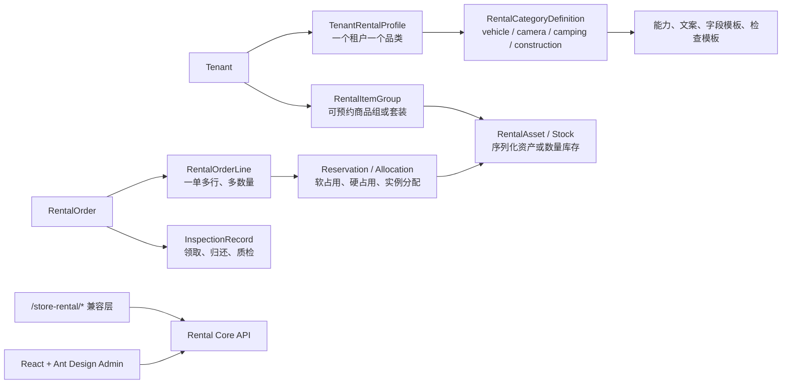

# 通用设备租赁与 React 管理端迁移计划

## 版本记录

| 版本 | 日期 | 作者 | 变更摘要 | 依据 |
| --- | --- | --- | --- | --- |
| v1.0 | 2026-08-12 | Codex / 项目负责人确认 | 确认“单品类租户的通用设备租赁内核”与“React + Ant Design 营运端”方向，定义数据、API、前端和切换计划 | 当前代码审计、`DOMAIN_BOUNDARY_DECISIONS.md`、`GENERAL_RENTAL_MIGRATION_GUIDE.md`、项目负责人决定 |
| v1.1 | 2026-08-12 | Codex / 项目负责人确认 | 锁定新端必须从最新稳定版 React 19.2.8、React DOM 19.2.8、Ant Design 6.6.0 开始建设 | npm registry 实时核对、项目负责人决定 |
| v1.2 | 2026-08-12 | Codex | 创建 `apps/admin-next`，完成 React 管理端基础设施、现有业务域只读投影，并验证生产构建；根 `dev` 默认改为 API + React 端 | 本地构建、工作区依赖核对 |
| v1.3 | 2026-08-12 | Codex | 补齐现有车辆兼容 API 下的订单创建、合同、商业规则、会员审核、资产调拨、集成运维页面；加入直接路由权限守卫与路由级代码拆分 | React 生产构建、开发服务与只读 API 联调 |
| v1.4 | 2026-08-12 | Codex | 完成 React 端现有 API 范围内的主要维护闭环：财务单据/预授权/调账、定价与营销、个人与企业客户、组织用户角色、系统参数、TBox 绑定与指令；增加 React 静态契约检查 | 全工作区构建/类型检查、API 契约与静态审计；浏览器交互待项目负责人验收 |
| v1.5 | 2026-08-12 | Codex / 项目负责人确认 | React 管理端正式接替 `apps/admin`，补齐资产生命周期、业务控制台和平台治理工具，删除旧 Vue 源码、依赖、构建脚本和临时 `apps/admin-next` 目录 | React 全量构建、静态契约、依赖树和零 `.vue` 文件审计；浏览器交互由项目负责人验收 |
| v1.6 | 2026-08-12 | Codex | 依据 Git `HEAD` 中旧 Vue 路由、页面 API 调用与当前 React 实现做端点级差异审计，补回规则版本、网点层级、租户列表、组织启停、二次确认检查、Mock 适配器调用以及位置/维保/事故记录编辑 | 37 个旧路由零缺口、165 个旧 API 导出完整保留、152 个旧页面使用的端点函数零缺口 |
| v1.7 | 2026-08-13 | Codex / 项目负责人确认 | 以 Ant Design v6 官方 `design.md` 重构登录页、全屏后台框架、分组菜单和业务页公共布局；主题收敛为官方 Default/Dark/Compact 算法 | 官方 `design.md`、React 类型检查、静态视觉契约与生产构建 |

## 1. 已确认的方向

### 1.1 产品边界

- 平台改造成多类型设备租赁 SaaS，首期品类至少包括：露营设备、摄影设备、车辆载具、工程设备。
- **一个租户对应一个租赁品类**。租户不是只能出租一个商品：同一摄影租户可同时出租相机、镜头、灯光和套装；同一露营租户可同时出租帐篷、桌椅和炉具。
- 汽车门市租赁保留为 `vehicle` 品类的兼容适配场景，不再作为平台内核的默认概念。
- 新营运端固定采用 **React 19.2.8 + Ant Design 6.6.0**。新页面不再引入 Vue、Pinia、Vue Router 或 Element Plus。

### 1.2 不成立的做法

以下做法不满足目标，实施时不得采用：

| 做法 | 问题 | 正确替代 |
| --- | --- | --- |
| 把 `Vehicle` 全局改名为 `Equipment` | 仍会保留单车辆、车牌、里程、油电、调度等隐含约束 | 建立通用资产、库存、订单行、检查和占用模型 |
| 用租户文案替换车辆页面的文字 | 摄影套装、露营数量库存、工程设备资质无法正确履约 | 文案、字段模板、检查模板和能力均由品类配置驱动 |
| 每个新设备品类复制一套车辆模块 | 规则、资金、库存和权限会分叉，后续无法维护 | 所有品类复用租赁内核，少量品类适配器处理差异 |
| 未完成能力盘点就直接删除 Vue | 容易遗漏订单、资金、履约和治理能力 | 先完成 API/路由/页面对照，再由 React 正式接替；本次已按此流程完成 |
| 长期双写旧车辆表和新资产表 | 占用、费用和订单状态很容易不一致 | 每个阶段只能有一个事实源；旧 API 通过兼容适配层读取新内核 |

## 2. 当前事实与迁移前提

截至本版本，以下为已核对的当前事实：

- `apps/admin` 已是 React 19 + Vite + TypeScript + Ant Design 6 的单体 SPA，旧 Vue 应用已删除。
- 迁移前基线包含 36 个 Vue 视图、38 个路由和 165 个 API client 导出函数；这些能力已完成路由/API 对照并在 React 中按领域重组，不再保留 Vue 运行时或 `.vue` 源文件。
- `packages/shared`、`apps/api/src/modules/store-rental`、Prisma schema、API 路径和前端路由均有显著的车辆命名耦合。
- 当前订单直接关联一个 `VehicleGroup` 和一个 `Vehicle`；这不能表达摄影器材套装或露营设备多数量订单。
- React 构建、类型检查和静态契约已经恢复可信基线；MySQL 全流程回归、后端数据权限和真实认证仍未完成收口，不能因前端替换完成而视为生产就绪。

本计划不是宣布当前后端已经通用化。React 管理端已正式接替 `apps/admin` 并成为唯一营运端，但它目前仍主要消费 `/store-rental/*` 车辆兼容 API；前端技术替换完成，不等于多品类租赁内核完成。

## 3. 目标架构



### 3.1 平台内核与品类适配

| 层级 | 职责 | 允许的差异 |
| --- | --- | --- |
| 租赁内核 | 租约、订单行、库存占用、交付/归还、费用账本、押金、月结、审计、权限、快照 | 不含任何车辆字段或汽车文案 |
| 品类定义 | 品类代码、启用能力、术语、资产属性 schema、使用量指标、检查模板 | `vehicle`、`camera`、`camping`、`construction` 等预定义品类 |
| 租户租赁档案 | `categoryCode`、租户展示文案、已启用履约方式/能力、模板版本 | 只允许在租户初始化或显式迁移时变更 |
| 适配器 | 汽车 TBox、车辆调度、工程设备资质、智能柜、物流等 | 仅在对应能力启用时加载 |

`TenantRentalProfile.categoryCode` 是租户创建时的业务决定。已有生产数据的租户不能直接把 `vehicle` 更新成 `camera`；必须新建租户，或执行含备份、字段映射、订单快照保留和回归验证的显式品类迁移。

### 3.2 新领域模型

| 新模型 | 关键字段/约束 | 取代的当前概念 |
| --- | --- | --- |
| `RentalCategoryDefinition` | `code`、能力、术语、属性 schema、检查模板 schema、使用量定义 | 隐含的汽车业务线 |
| `TenantRentalProfile` | `tenantId` 唯一、`categoryCode`、启用能力、UI/模板版本 | 租户内散落的车辆文案与默认规则 |
| `FulfillmentLocation` | 履约方式、自提/归还/寄送能力、容量、可用状态 | 门市/站点 |
| `RentalItemGroup` | `code`、名称、库存模式、可替代规则、定价属性、套装定义 | 车型组/产品组 |
| `RentalAsset` | 资产编号、序列号、位置、资产状态、维护状态、受控 attributes | 车辆实例 |
| `RentalStockBalance` | 标的组、地点、可用/占用/维修/清洁数量 | 只适用于单车的可用数量 |
| `RentalOrder` + `RentalOrderLine` | 订单快照、多个标的行、数量、价格与检查模板版本 | 一个订单只关联一个车型组/车辆 |
| `RentalReservation` / `RentalAllocation` | 软占用、确认占用、履约占用；按数量或资产实例分配 | 订单状态中隐含的车辆占用 |
| `InspectionTemplate` + `InspectionRecord` | 阶段、模板版本、字段结果、异常、附件、签名 | 固定车牌/里程/油电量检查表 |
| `UsageReading` | 指标代码、开始/结束值、单位、来源、审计 | 里程及油电专用字段 |
| `AssetMaintenance` / `AssetIncident` | 通用维护、损坏、事故/异常、费用责任 | 车辆维保和事故专表 |

主表只保留需要查询、约束和审计的通用字段。汽车 VIN/车牌、摄影快门数/卡口、露营容量/重量、工程设备吨位等显示差异放在经过品类 JSON Schema 校验的 `attributes` 中；不能把占用、检查结果、费用或合规证照塞进无约束 JSON。

### 3.3 库存与履约能力

| 品类 | 库存模式 | 使用量 | 领取/归还检查 | 特有能力 |
| --- | --- | --- | --- | --- |
| 车辆载具 | `serialized` | 公里、油量/电量 | 车况、证照、签名 | TBox、跨网点、调度 |
| 摄影设备 | `serialized` + `bundle` | 快门次数、使用时长 | 机身/镜头/配件、传感器、照片 | 配件绑定、智能柜可选 |
| 露营设备 | `quantity` + `bundle` | 无或损耗等级 | 组件、清洁、破损、缺件 | 套装拆分/组合、清洁周转 |
| 工程设备 | `serialized` | 工作小时、里程 | 安全状态、附件、交接 | 资质、运输、维保、调度 |

稳定的订单状态可保留 `pending_payment`、`reserved`、`inspecting`、`renting`、`renewing`、`overdue`、`settlement_pending`、`payment_due`、`refund_pending`、`completed`、`cancelled`、`no_show`、`closed`。新内核将 `pickup_overdue` 改为 `fulfillment_overdue`、`accident_processing` 改为 `issue_processing`；汽车兼容层负责旧状态和旧文案的映射。

## 4. API、数据与兼容策略

### 4.1 API 边界

- 新通用 API 采用 `/api/rental/v1/*`，例如 `item-groups`、`assets`、`availability`、`orders`、`inspections`、`fulfillment-locations`。
- 现有 `/api/store-rental/*` 在迁移期保留，但只作为 `vehicle` 品类的兼容 facade；不得继续在该路径添加新通用能力。
- 新 API 先完成共享 DTO、OpenAPI operation、权限、请求 DTO 校验和后端数据范围过滤，再允许 React 页面依赖。
- 权限由 `store-rental:*` 平滑映射为 `rental:*`；后端允许旧/新任一权限命中，完成角色模板迁移后再移除旧码。
- 所有查询必须基于认证用户注入租户、组织/网点/本人数据范围；React 的菜单隐藏只用于交互，不能承担隔离职责。

### 4.2 数据迁移规则

1. 新增通用表、索引和约束，不改写已有历史迁移文件。
2. 为每个已有汽车租户创建 `TenantRentalProfile(categoryCode=vehicle)`。
3. 回填 `VehicleGroup -> RentalItemGroup`、`Vehicle -> RentalAsset`、`StoreStation -> FulfillmentLocation`；保留 `legacyId` 和历史快照引用以便回溯。
4. 将旧订单回填为一个或多个 `RentalOrderLine`，将已绑定车辆回填为 `RentalAllocation`；已完成订单只读保留，不按新规则重新计价。
5. 迁移完成后，旧汽车 API 改为调用通用内核和返回旧 DTO，避免长期双写。
6. 每个数据库迁移均需可重复验证、备份、行数/金额/占用对账和失败回滚方案；历史订单、费用、流水、合同与审计不得丢失。

### 4.3 关键接口迁移映射

| 当前 | 新接口/模型 | 兼容策略 |
| --- | --- | --- |
| `/store-rental/vehicle-groups` | `/rental/v1/item-groups` | `vehicle` facade 映射旧 DTO |
| `/store-rental/vehicles` | `/rental/v1/assets` | `vehicle` facade 映射车牌、VIN、里程等扩展字段 |
| `/store-rental/stations` | `/rental/v1/fulfillment-locations` | 保留旧门市/站点读写 facade |
| `/store-rental/availability` | `/rental/v1/availability` | 支持标的组、多数量、地点和履约方式 |
| `/store-rental/pricing/*` | `/rental/v1/pricing/*` | `vehicleGroupCode` 改为 `itemGroupCode` |
| `/store-rental/orders` | `/rental/v1/orders` | 旧单标的订单投影为一行订单 |
| 取车/还车验车动作 | `/rental/v1/orders/:id/inspections` | 汽车动作名仅在 facade 保留 |
| 车辆调度/TBox | `/rental/v1/adapters/*` 或能力接口 | 仅 `vehicle`/`construction` 能力启用 |

## 5. React + Ant Design 目标前端

### 5.1 技术基线

React 应用已由临时并行目录正式迁入 `apps/admin`，该目录是唯一营运端。技术依赖如下：

| 责任 | 选型 | 约束 |
| --- | --- | --- |
| UI 运行时 | React **19.2.8** + React DOM **19.2.8** + TypeScript + Vite | 从当前最新稳定版开始；函数组件和严格类型检查 |
| 路由 | React Router | 路由元数据统一承载标题、权限、品类能力 |
| 组件库 | Ant Design **6.6.0** | 从当前最新稳定版开始，使用 `ConfigProvider` 主题 token；新页面不使用 Element Plus |
| 图标与日期 | `@ant-design/icons` **6.3.2**、`dayjs` | 不保留 Element Plus Icons 依赖 |
| 服务端状态 | TanStack Query | 列表、详情、报价、报表统一缓存/失效，不用全局 store 承载服务端数据 |
| 客户端状态 | Zustand | 仅登录态、租户档案、布局和短期 UI 状态 |
| HTTP | Axios | 延续 token、租户上下文、401 清理；按业务域拆分 API 函数 |
| 表单 | Ant Design Form | 高风险订单/费用动作使用明确校验、二次确认和提交态 |
| 样式 | Ant Design token + 小范围 CSS Modules/global CSS | 新应用不引入 Tailwind，避免 Preflight 和两套组件样式体系冲突 |

视觉实现遵守 Ant Design v6 官方 `design.md`，并以官网 Light / Dashboard 示例作为后台框架的明确视觉目标：真实后台采用 6px 浏览器边缘留白、14px 圆角、1px 语义边框和克制阴影形成完整应用窗口，窄屏自动取消留白与圆角；窗口内默认 Light 使用 `#f5f8ff` 工作区以及白色顶栏、白色侧栏和面包屑上下文区。这个外框只借用示例的空间与材质关系，不复制固定高度或演示数据。面包屑承担页面定位，其中业务分组层提供同组页面下拉选择；业务页取消大标题与说明副标题。官网示例中的大圆角“页签”实际为 Segmented，项目中的 Segmented 和业务 Tabs 统一采用浅灰轨道、999px 圆角、白色选中项、600 字重和轻阴影。一级业务 Tabs 的轨道必须位于 `#f5f8ff` 页面背景上，与下方独立白色内容面板保持 12px 间距；不得再把“轨道 + 内容”整体包进一个白色 Card。只有作用域明确属于某个面板的二级 Tabs 可以保留在内容面板内。按钮沿用 Ant v6 的 6px 圆角、轻描边和圆形图标按钮，表格使用 8px 容器圆角、浅灰表头、12×8 单元格内边距及细分隔线。指标卡、视图切换、搜索筛选和主数据面板属于页面业务内容，应按场景组合，不能把示例的四指标加表格结构强加给所有页面。4px 网格、14px 正文、8px Card/Modal 圆角和语义色规则继续有效；业务页禁止装饰渐变和填充式 card tabs。

版本规则：以上版本是 2026-08-12 从 npm registry 核对并写入 lockfile 的稳定版本。后续升级时应再次执行 `npm view <package> version`，评估兼容性后记录版本；不得在 `package.json` 使用 `latest` 标签代替确定版本，必须提交 `package-lock.json` 以确保团队和 CI 使用同一依赖解析结果。

`packages/shared` 在迁移期仍是 DTO/枚举来源；不要复制一份前端类型。Vite 已显式指向工作区内的 `packages/shared/src`；`@store-rental/shared` workspace Junction 已核对指向 `packages/shared`，React 生产构建通过。

### 5.2 推荐目录

```text
apps/admin/src/
  app/                 # App、providers、theme、router、route guards
  api/                 # axios instance、错误归一化、API 域模块
  features/
    auth/
    tenant-profile/
    rental-catalog/    # item groups、assets、locations
    pricing/
    orders/
    fulfillment/
    finance/
    operations/
    platform/
  components/          # PageHeader、PermissionGate、DataTable 等通用组件
  hooks/                # Query hooks、权限和品类能力 hooks
  styles/               # token 覆盖与小范围全局样式
```

迁移已按领域拆为页面容器、查询状态、动作面板和通用展示组件。后续禁止重新形成同时承载 API、状态机、表单、弹窗和展示的巨型页面。

### 5.3 Ant Design 组件映射

| Vue / Element Plus | React / Ant Design | 迁移要求 |
| --- | --- | --- |
| `el-form` | `Form` | 字段 schema 只负责简单资产属性/检查项；复杂订单流程仍使用明确业务组件 |
| `el-table` | `Table` | 列定义独立；分页、筛选、排序由 URL + Query 管理 |
| `el-dialog` / `ElMessageBox` | `Modal` / `Popconfirm` | 资金、状态、删除动作必须二次确认 |
| `ElMessage` | `App.useApp().message` / `notification` | 在应用 provider 内统一调用 |
| `el-drawer` | `Drawer` | 详情、快速处理和历史记录统一使用 |
| `el-tabs` / `el-steps` | `Tabs` / `Steps` | 订单履约通过步骤组件体现状态机，不在前端自行改变状态 |
| `el-tree` | `Tree` | 组织与履约网点树需保留权限和选中状态 |
| `el-dropdown` / `el-menu` | `Dropdown` / `Menu` / `Layout.Sider` | 菜单由租户品类能力和权限动态生成 |

### 5.4 路由、菜单和品类文案

React Shell 登录后先读取 `TenantRentalProfile`。它输出 `itemLabel`、`itemGroupLabel`、`fulfillmentLabel`、领取/归还文案和 capabilities。路由定义保留稳定的通用路径，菜单按能力显示：

| 新通用路由 | 通用页面 | `vehicle` 租户示例文案 | `camera` 租户示例文案 |
| --- | --- | --- | --- |
| `/rental/item-groups` | 标的分组 | 车型组 | 器材组 |
| `/rental/assets` | 资产与库存 | 车辆档案 | 器材资产 |
| `/rental/locations` | 履约网点 | 门市/站点 | 门店/仓库 |
| `/rental/orders/new` | 新建订单 | 新建租车订单 | 新建器材订单 |
| `/rental/orders` | 订单列表 | 门市租赁订单 | 摄影器材订单 |
| `/rental/orders/:id` | 订单详情 | 取车/还车/验车 | 领取/归还/质检 |
| `/rental/operations` | 资产运营 | 车辆调度 | 资产准备与归还质检 |

不要用运行时字符串替换掩盖字段差异。例如相机的“快门次数”和露营设备的“组件缺失”分别来自 `UsageReading` 和 `InspectionTemplate`，而不是把车辆页面的“里程”标签替换掉。

## 6. 前端页面迁移顺序

| 波次 | 当前 Vue 范围 | React 目标 | 前置依赖 | 切换门槛 |
| --- | --- | --- | --- | --- |
| R0 | 无 | React 工程、主题、登录、App Shell、权限/能力路由守卫、HTTP/Query 基础设施 | 构建基线、认证契约 | React 可登录、登出、401 清理、权限拒绝和菜单过滤 |
| R1 | `OrganizationManagement`、`UserManagement`、`Permissions`、系统参数 | 平台管理基础页 | 数据权限后端过滤、`TenantRentalProfile` | 不同角色和租户无法读取越权数据 |
| R2 | `Stations`、`VehicleGroups`、`Vehicles`、`VehicleStatusList`、`VehicleTransfer` | 履约网点、标的分组、资产/库存、资产状态、调拨 | 通用资产/库存/位置 API 和数据回填 | 车辆、摄影、露营两种库存模式均可维护与查询 |
| R3 | `RentalRules`、`ProductPricing`、`DynamicPricing`、`Marketing`、`ValueAddedServices` | 通用规则、定价、营销、增值服务 | `itemGroupCode` 定价与规则版本 | 报价快照能解释品类规则来源 |
| R4 | `NewOrder`、`Orders`、`OrderDetail`、合同页 | 多行订单、可用性、资产分配、领取/归还检查、费用和合同 | 订单行/占用/检查/资金 API，真实 MySQL 回归 | 车辆与摄影各完成一条订单闭环，金额和占用可对账 |
| R5 | `Dispatch`、`TboxManagement`、`VehicleConsole`、报表/财务/通知/任务 | 按 capability 显示的运营、IoT、财务、报表和辅助页 | 资产适配器、数据权限、导出/审计 | 非车辆租户不显示车辆专有入口；车辆租户保持完整能力 |
| R6 | 旧 Vue `apps/admin` | React 正式接管、删除 Vue 源码和依赖 | 路由/API/页面能力对照 | 已完成；`apps/admin` 是唯一前端入口，代码库不保留旧端 |

当前页面不需要逐个翻译后再上线。R4 的订单创建、订单详情和履约/资金是风险最高域，应在独立 React 业务组件与真实 API 回归完成后切换；禁止用 iframe 或在 React 页面中嵌入 Vue 页面作为长期方案。

## 7. 分阶段实施计划

### Phase 0：保护基线与决定发布方式

- 修复 workspace 依赖链接，恢复 `build`、`lint`、契约校验和 Prisma 校验的可信基线。
- 保护当前本地领先远端的提交历史；先确定备份/推送策略，禁止以迁移名义覆盖历史分支。
- 启动 MySQL/Redis，建立可重复初始化和至少一条真实 API 的订单回归；服务未启动时 E2E 必须失败，不得只计为跳过。
- 落实后端数据权限和认证整改计划。React 迁移不解决服务端越权或 mock token 问题。

### Phase 1：通用租赁后端与数据模型

- 新增 `TenantRentalProfile`、通用资产/库存、订单行、占用、检查模板/记录、使用量和通用履约地点。
- 建立 `rental-core`、`inventory`、`fulfillment` 模块与 `/api/rental/v1/*` 合同。
- 为汽车数据完成迁移演练、数据对账和 `/store-rental/*` 兼容 facade。
- 使用 `vehicle` 与 `camera` 两个种子租户验证序列化资产；使用 `camping` 租户验证数量/套装库存。

### Phase 2：React + Ant Design 基础应用

- React 已正式迁入 `apps/admin`；根 `npm run dev` 默认启动 API + React 营运端，不再存在 legacy Vue 启动命令。
- 已建立 Ant Design `ConfigProvider`、主题 token、`App` provider、React Router、TanStack Query、Zustand auth store 和 Axios client，端口为 `5175`。
- 已迁入运营概览、标的分组、资产、履约网点、订单、合同、商业规则、客户、财务、运营、报表与平台配置；页面明确标识旧车辆 API 限制。
- 已接通现有 API 能力的标的分组/资产/网点兼容维护，订单可用性检查、报价、单标的订单创建与状态动作，合同生成/模拟打印/模拟签署，规则/定价/营销/增值服务维护，个人客户与企业客户维护、会员审核/风险/等级维护，财务单据/预授权/调账/对账，调度任务与资产调拨状态流转，TBox 绑定和车辆指令，组织/用户/角色/系统参数，报表导出任务、安全基线维护、模拟通知和异步任务执行。
- 旧路由已建立 React 重定向，避免历史书签落入兜底页；旧 Vue 源码、依赖、脚本和临时目录均已删除。
- 所有业务路由使用 `React.lazy` 拆分；菜单权限之外增加直接 URL 权限拒绝页。该前端保护只改善交互，后端仍必须负责租户与数据范围隔离。
- 已通过根目录 `npm run build` 和 React 静态契约检查；开发中的 API 健康检查、React 首页和订单/规则/合同/会员/调拨/集成/安全只读端点已联调返回成功。本轮按项目负责人要求未打开浏览器，交互回归由项目负责人手工验收；不同角色权限矩阵、多租户 E2E 与真实 MySQL 订单闭环仍未完成。
- 现有订单创建仍是车辆兼容内核的单标的订单，不能表达多行、数量库存或套装；合同打印/签署、通知和部分集成仍是 mock/reserved，不得作为生产接入完成的证据。

### Phase 3：通用资产与商业规则页面

- 先迁履约地点、标的分组、资产/库存、资产维护/调拨，再迁规则、定价、营销和增值服务。
- 为字段和检查模板建立可复用渲染器，但只用于资产属性、检查项等配置型内容；不把所有后台页面抽成万能动态表单。
- 每完成一个页面域，比较 Vue 兼容 API 与通用 API 的关键结果；不一致时先修后端契约，不能在前端做补丁掩盖。

### Phase 4：订单、履约和资金切换

- 实现多行订单、数量库存/序列化资产分配、软/硬占用、领取/归还检查、损坏/缺件费用和快照追溯。
- 按“报价 -> 创建订单 -> 支付/授信 -> 领取 -> 归还 -> 结算 -> 资产释放 -> 报表”做真实 MySQL 回归。
- 先在内部/演示租户启用 React 订单域，完成数据和金额对账后才将其设为默认入口。

### Phase 5：运营能力和正式切换（前端已完成）

- 将调度、IoT、物流、智能柜、资质和报表拆为 capability 驱动模块；车辆或工程设备启用调度，摄影/露营默认不显示车辆调度与 TBox。
- 资产生命周期、调度优化、订单辅助账本、企业月结、平台治理、文件/打印/任务与完整报表工具已迁入 React。
- React 已成为唯一管理端；旧 Vue 端不再保留，现有 `/store-rental/*` 仍是后端车辆兼容 facade，不存在前端双写。
- 回滚仅切换前端入口；数据层迁移必须已完成备份和向前兼容，不能依赖破坏性回滚 migration。

## 8. 验收门槛与风险控制

### 8.1 每阶段必须通过

- `npm run build`、类型检查、OpenAPI/契约校验、Prisma 校验和格式检查恢复并通过。
- React 单元/组件测试通过；关键业务 E2E 使用真实登录令牌、真实服务和可重置的隔离数据。
- MySQL 模式下完成租户、资产、订单、费用、调度/运营和报表的回归；内存模式仅作为开发 fallback。
- 后端按租户和数据范围过滤；前端不可见不等于后端不可访问。
- 每次 schema/data migration 具备备份、数据量/金额/占用对账与恢复演练。

### 8.2 正式切换的最低验收

| 场景 | Given | When | Then |
| --- | --- | --- | --- |
| 摄影租户 | 已配置 `camera` 品类和器材/镜头/灯光库存 | 创建包含多行标的的订单并完成领取归还 | 正确占用/释放实例与配件，检查、费用和快照可追溯 |
| 露营租户 | 已配置 `camping` 品类、套装和数量库存 | 领取后归还时标记缺件/清洁问题 | 库存数量正确、异常生成对应费用和质检记录 |
| 车辆租户 | 已迁移现有汽车数据 | 使用旧兼容入口或新 React 入口完成订单 | 金额、资产占用、合同、审计与原记录可对账 |
| 数据隔离 | 两个不同品类租户、不同数据范围用户 | 请求列表、详情、导出和订单动作 | 不能读取或操作其他租户/越权网点数据 |
| 前端切换 | React 域已覆盖现有前端流程 | 切换默认入口 | `apps/admin` 只含 React/Ant Design，无 Vue 源码或运行时依赖 |

### 8.3 主要风险与处理

| 风险 | 后果 | 控制措施 |
| --- | --- | --- |
| 先搬前端、后定通用 API | React 页面会把车辆概念重新固化 | 先冻结 DTO/API 合同，再迁页面 |
| 通用化过度配置化 | 规则不可审计、表单不可用 | 固定内核 + 受 schema 约束的属性/检查模板 + 少量 capability 适配器 |
| 多行订单未先落库 | 摄影套装和露营数量库存无法正确占用 | R4 前必须完成订单行/占用模型 |
| React 与 Vue 长期双写 | 数据、库存、金额不一致 | 单一事实源，旧端仅 facade 兼容 |
| 组件逐行翻译 | 巨型页面复杂度原样迁移 | 页面先拆数据、动作和展示，再在 React 重组 |
| 把前端权限当隔离 | 越权读取/操作 | 后端查询层统一注入数据范围，并有多租户 E2E |

## 9. 当前待确认但不阻塞本计划的事项

| 问题 | 影响 | 建议确认时点 |
| --- | --- | --- |
| 首个非车辆试点选摄影还是露营 | 决定先验证序列化资产还是数量/套装库存 | Phase 1 开始前；建议摄影与露营均作为验收样本 |
| 是否允许同一订单跨多个履约地点 | 影响订单行和物流/库存分配模型 | Phase 1 订单模型定稿前 |
| 工程设备是否包含操作员、运输和资质服务 | 影响服务订单、权限和履约能力 | 工程设备品类进入开发前 |
| React 发布域名与部署编排 | 影响生产代理、静态资源和回滚方式 | 正式部署前；代码目录已固定为 `apps/admin` |

## 10. 后续开发约束

- 新增领域能力优先落在 `rental-core`、`inventory`、`fulfillment` 或 capability adapter；不得继续向 `store-rental` 增加通用功能。
- 新增前端页面只在 `apps/admin` 的 React + Ant Design 应用中实现；不得重新引入 Vue 运行时、Vue 构建插件或 `.vue` 文件。
- 新租户初始化必须选择且仅选择一个租赁品类，并生成相应角色、术语、能力、模板和演示数据。
- 订单、价格、规则、检查模板和品类档案必须版本化或快照化，历史订单始终按照创建时语义可回溯。
- 无法明确归属内核或品类适配器的需求，先补业务规则和验收，不直接实现。
